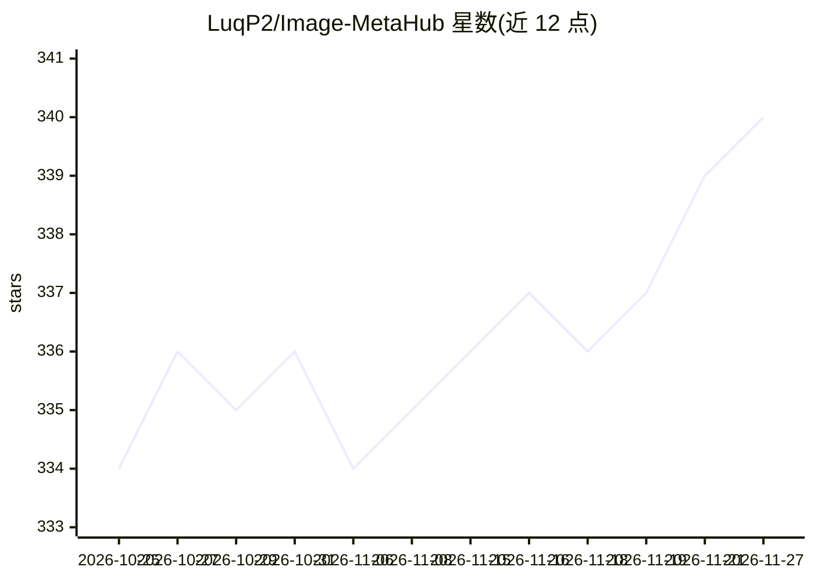

# LuqP2/Image-MetaHub

⭐ 340 · TypeScript · MPL-2.0 · 推送 2026-11-25 · [GitHub](https://github.com/LuqP2/Image-MetaHub) · [官网](https://imagemetahub.com) · 个人维护

**本地优先的 AI 生成图库管理器：按提示词/模型/相似度检索**

本地运行的桌面媒体库应用，将 ComfyUI、Automatic1111、InvokeAI 等生成工具的输出文件夹索引为可搜索库：按提示词、模型、LoRA、采样器、标签等元数据过滤，另提供本地视觉相似搜索（需单独下载模型，支持 GPU 加速）。支持图片、视频、音频与 3D 格式浏览，展示生成参数与血缘链，管理提示词与本地模型文件，并可在应用内连接运行中的 ComfyUI 或 Automatic1111。核心功能免费，Pro 订阅解锁模型管理、生成与批量工具。

## 筛选速览

| 维度 | 判定 | 备注 |
|---|---|---|
| AI 角色 | `ai-enhanced` | 去掉 AI 部分产品仍成立 |
| 许可风险 | `permissive` | MPL-2.0 |
| 部署形态 | `library` | 以包/库形式分发 |
| 模型依赖 | — | README 未给出锁定关系 |
| 硬件要求 | — | 无带数字的原话,不猜 |
| 安装摩擦 | `low` | 无编译、无系统依赖或容器化 |
| 成熟度 | — | 结构信号不足 |

## 能力要点

- 按提示词、checkpoint、LoRA、采样器、ComfyUI 节点等元数据组合过滤检索
- 本地视觉相似搜索与文生图视觉查询，支持离线运行
- 读取 ComfyUI/A1111/InvokeAI 等十余种工具的生成元数据，展示血缘链与来源
- Pro 内置 ComfyUI Workspace 与 Automatic1111 API 集成，可生成与下发参数

## 适用场景

- 在海量出图文件夹里按提示词或 LoRA 找回某张生成图
- 整理、打标并收藏本地扩散模型的输出媒体
- 在应用内直接查看图片生成参数并回传 ComfyUI 继续出图
- 统一管理本地 checkpoints、LoRA 等模型文件并跟踪更新

## 场景标签

`语义搜索` `图像视频处理` · 领域:知识与检索

## 证据(README 行号)

> L5: Image MetaHub turns your output folders into a searchable desktop library. Find an image by its prompt, model, LoRA,
> L33: **Find Similar** searches for visually related images, including files with no generation metadata. It runs locally
> L106: ## Free and Pro

## 星数曲线

2026-10-25 334 → 2026-11-27 340（+6）

---
*卡片 v1 · prompt 1.4 · 生成 2026-11-25 · 置信度 high · 依据 README sha `020f82aaa39b` · [字段定义](../../DATASET.md)*
