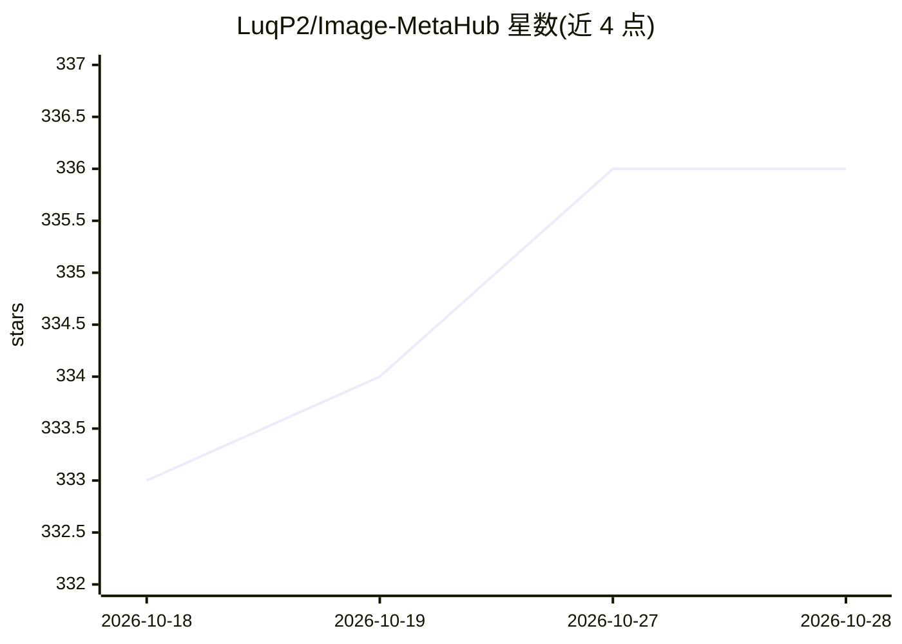

# LuqP2/Image-MetaHub

⭐ 336 · TypeScript · NOASSERTION · 推送 2026-10-27 · [GitHub](https://github.com/LuqP2/Image-MetaHub) · [官网](https://imagemetahub.com) · 个人维护

**本地优先的 AI 生成图像管理与检索桌面应用**

面向 AI 图像生成用户的桌面媒体库：扫描本地输出文件夹，读取 ComfyUI、Automatic1111、InvokeAI、Forge 等十余种工具的生成元数据，支持按提示词、模型、LoRA、采样器等条件搜索与过滤，并可做本地视觉相似搜索（需单独下载模型）。提供谱系追踪、提示词库、比较视图、媒体播放与 3D 查看等功能。核心库免费，生成对接、模型管理、图像编辑等归入付费 Pro；采用 PolyForm Perimeter 源码可得许可，禁止竞争产品用途。

## 筛选速览

| 维度 | 判定 | 备注 |
|---|---|---|
| AI 角色 | `ai-enhanced` | 去掉 AI 部分产品仍成立 |
| 许可风险 | `none` | NOASSERTION |
| 部署形态 | `library` | 以包/库形式分发 |
| 模型依赖 | — | README 未给出锁定关系 |
| 硬件要求 | — | 无带数字的原话,不猜 |
| 安装摩擦 | `low` | 无编译、无系统依赖或容器化 |
| 成熟度 | — | 结构信号不足 |

## 能力要点

- 读取 10+ 生成工具的元数据，按提示词/模型/LoRA/节点过滤搜索
- 本地视觉相似搜索（Find Similar），支持暂停索引与可选 GPU 加速
- 支持图片/视频/音频/3D（GLB/FBX 等）统一库管理
- ComfyUI Workspace 与 Automatic1111 API 集成（Pro）

## 适用场景

- 我想在大量 AI 出图中按提示词或 LoRA 快速找回某张图
- 我想管理本地 checkpoints/LoRA 文件并跟踪 Civitai 更新
- 我想保存提示词并回到 ComfyUI/A1111 继续创作

## 场景标签

`提示工程` `语义搜索` · 领域:Agent 开发

## 证据(README 行号)

> L5: Image MetaHub turns your output folders into a searchable desktop library. Find an image by its prompt, model, LoRA,
> L33: **Find Similar** searches for visually related images, including files with no generation metadata. It runs locally

## 星数曲线

2026-10-18 333 → 2026-10-28 336（+3）

---
*卡片 v1 · prompt 1.4 · 生成 2026-10-22 · 置信度 high · 依据 README sha `a6f61cb957b0` · [字段定义](../../DATASET.md)*
