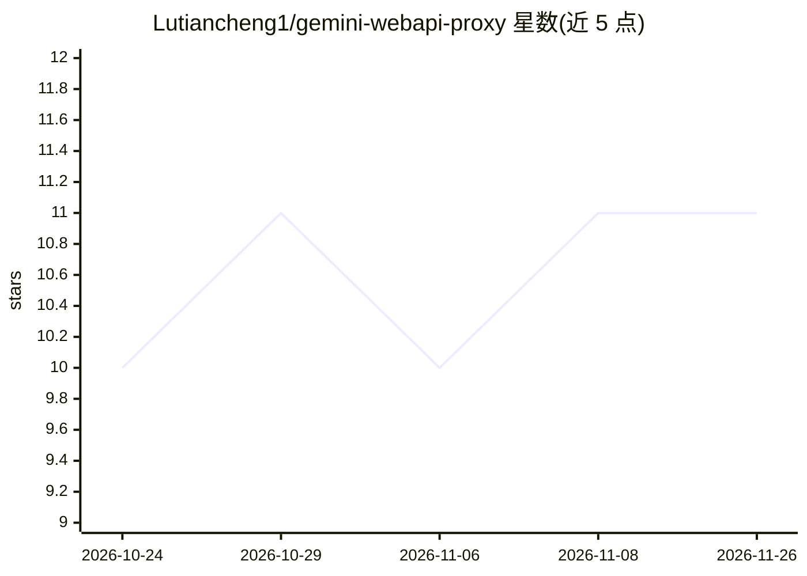

# Lutiancheng1/gemini-webapi-proxy

⭐ 11 · Python · GPL-3.0 · 推送 2026-06-24 · [GitHub](https://github.com/Lutiancheng1/gemini-webapi-proxy) · [官网](https://github.com/Lutiancheng1/gemini-webapi-proxy/tree/main/docs) · 个人维护 · 中文 README

**把 Gemini 网页登录转成 OpenAI 兼容接口的代理网关**

基于 FastAPI 的反向工程代理：复用浏览器中已登录的 Gemini Web 会话（Safari/Chrome cookies、环境变量或 cookies.txt），对外提供 OpenAI 兼容的 chat completions 与图像生成端点，任何 OpenAI 客户端只需替换 base_url 即可接入，无需官方 API key。图像输出统一为 base64，内置多级图片下载链与上游拒答检测。限制：不支持流式输出（stream=true 返回 400）、依赖 gemini-webapi 反向工程客户端、使用受 Google 服务条款约束。

## 筛选速览

| 维度 | 判定 | 备注 |
|---|---|---|
| AI 角色 | `ai-ecosystem` | LLM/agent 周边工具 |
| 许可风险 | `viral` | GPL-3.0 |
| 部署形态 | `self-host` | docker 或自建部署 |
| 模型依赖 | — | README 未给出锁定关系 |
| 硬件要求 | — | 无带数字的原话,不猜 |
| 安装摩擦 | `low` | 无编译、无系统依赖或容器化 |
| 成熟度 | — | 结构信号不足 |

## 能力要点

- OpenAI 兼容端点：chat completions 与图像生成（base64 输出）
- 三种 cookie 来源：桌面浏览器、环境变量、Netscape cookies.txt
- 可插拔架构：cookie 源、图片下载器、Gemini 客户端均可扩展
- Docker 一键部署，支持 macOS Safari cookie 自动同步

## 适用场景

- 让 LobeChat、NextChat、ChatBox 等客户端直接使用 Gemini Web 会话
- 脚本中通过 OpenAI SDK 调用 Gemini 对话与文生图
- 本地或服务器上长期运行一个免 API key 的 Gemini 网关

## 场景标签

`模型网关` `图像生成` · 领域:Agent 开发

## 证据(README 行号)

> L3: **OpenAI-compatible reverse-engineered gateway to Google Gemini Web (chat + image gen).**
> L53: - 🪄 **Drop-in OpenAI API** — point any OpenAI client (Python SDK, OpenAI CLI, ChatBox, NextChat, LobeChat, Outsider
> L186: ┌─────────────── FastAPI (uvicorn) ───────────────┐

## 星数曲线

2026-10-24 10 → 2026-11-26 11（+1）

---
*卡片 v1 · prompt 1.4 · 生成 2026-11-19 · 置信度 high · 依据 README sha `036fffa6e86a` · [字段定义](../../DATASET.md)*
