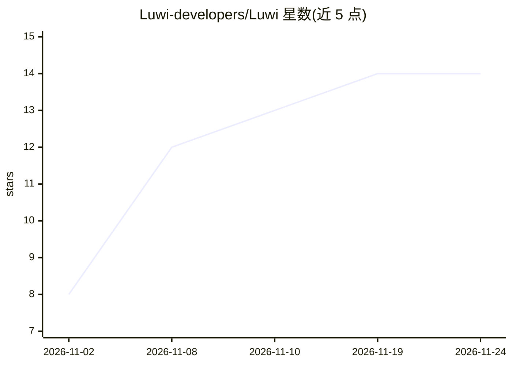

# Luwi-developers/Luwi

⭐ 14 · JavaScript · Apache-2.0 · 推送 2026-11-23 · [GitHub](https://github.com/Luwi-developers/Luwi) · [官网](https://github.com/Luwi-developers/Luwi/releases) · 个人维护 · 中文 README

**让 AI 操作安卓手机的端侧 Agent 应用（dsh 移植）**

把 deepseek-harness（dsh）移植到 Android 的应用：一台安卓设备同时充当 dsh 主机与受控端，界面为 WebView 中的 dsh Web GUI，原生层把屏幕、输入与系统能力封装成 61 个 `lw_*` 工具供模型调用。离线语音唤醒（zipformer KWS）与 SenseVoice 语音识别、端侧 OCR、多块虚拟屏后台执行任务、日程读写、快捷指令与基于通知/时间/地点等六类条件的自动指令。要求 Android 13 以上，虚拟屏需 Shizuku 或 root；APK 从 Releases 下载。

## 筛选速览

| 维度 | 判定 | 备注 |
|---|---|---|
| AI 角色 | `ai-native` | 本体是模型或模型工具 |
| 许可风险 | `permissive` | Apache-2.0 |
| 部署形态 | `None` |  |
| 模型依赖 | — | README 未给出锁定关系 |
| 硬件要求 | — | 无带数字的原话,不猜 |
| 安装摩擦 | `low` | 无编译、无系统依赖或容器化 |
| 成熟度 | `idea` | |

## 能力要点

- 61 个 `lw_*` 原生工具覆盖屏幕操作、OCR、应用启动、剪贴板、日程等设备能力
- 离线唤醒词与 SenseVoice 语音识别，音频不出设备
- 自建虚拟屏后台执行任务，支持插件协议 `lw-plugin/1` 扩展
- 自动指令支持通知/前台应用/光感/时间/地点/天气六类触发条件

## 适用场景

- 通过语音对话让 AI 代为操作手机完成自动化任务
- 锁屏离线唤醒后直接对话或读取屏幕内容
- 让模型按时间/通知等条件自动执行提醒或操作
- 在手机上用图生图模型修改屏幕截图

## 场景标签

`GUI 自动化` `语音识别` `OCR` `图像生成` · 领域:效率与自动化

## 证据(README 行号)

> L3: **DSH** for Android —— 把 deepseek-harness（dsh）装进手机的一个应用
> L74: 屏幕与输入是一套 dsh 原生工具（`lw_*`，共 61 个）：列屏 / 建屏 / 换尺寸 / 关屏 / 点 / 拖 / 长按 / 按键 / 组合键 / 打字 / 滚动 / 启动应用 / 打开链接 / 截图（可分区、可连拍、可拼
> L141: **不收集、不上传任何用户数据。** 包里没有统计 SDK、没有崩溃上报、没有安装编号、没有广告 ID。

## 星数曲线

2026-11-02 8 → 2026-11-24 14（+6）

---
*卡片 v1 · prompt 1.4 · 生成 2026-11-18 · 置信度 high · 依据 README sha `6365ae8001f6` · [字段定义](../../DATASET.md)*
