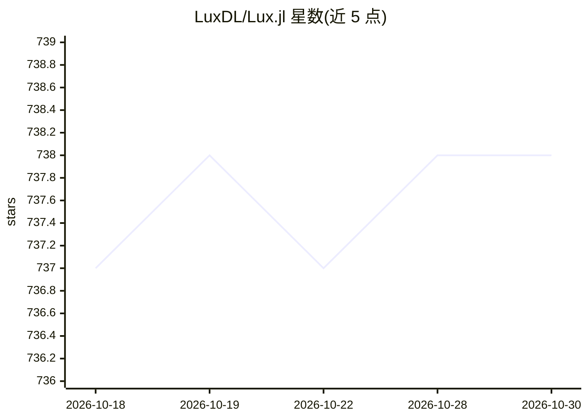

# LuxDL/Lux.jl

⭐ 738 · Julia · MIT · 推送 2026-10-29 · [GitHub](https://github.com/LuxDL/Lux.jl) · [官网](https://lux.csail.mit.edu/) · 个人维护

**Julia 语言深度学习框架：显式参数化建模，经 XLA 编译运行**

Julia 生态的深度学习库，核心特点是神经网络参数与模型结构显式分离的参数化方式，可通过 Reactant.jl 后端用 XLA 编译执行，也可走原生 Julia 与 Zygote 自动微分路径。提供 CUDA、AMDGPU、Metal、oneAPI 等可选 GPU 支持包。面向科研与科学机器学习场景（SciML），由 Avik Pal 等维护，附学术论文引用条目与 Colab 在线使用入口。

## 筛选速览

| 维度 | 判定 | 备注 |
|---|---|---|
| AI 角色 | `ai-native` | 本体是模型或模型工具 |
| 许可风险 | `permissive` | MIT |
| 部署形态 | `None` |  |
| 模型依赖 | — | README 未给出锁定关系 |
| 硬件要求 | — | 无带数字的原话,不猜 |
| 安装摩擦 | `medium` | 含编译或系统依赖之一 |
| 成熟度 | — | 结构信号不足 |

## 能力要点

- 参数与模型显式分离的神经网络定义方式
- 经 Reactant.jl 使用 XLA 编译，或原生 Julia + Zygote 两种路径
- 可选 CUDA/AMDGPU/Metal/oneAPI GPU 支持包
- 拆分为 LuxCore/LuxLib/MLDataDevices 等多个子包组织

## 适用场景

- 在 Julia 中构建和训练神经网络模型
- 科学机器学习（SciML）研究中的深度学习建模
- 需要跨 NVIDIA/AMD/Apple 等 GPU 硬件的训练代码

## 场景标签

 · 领域:深度学习/科学计算

## 证据(README 行号)

> L18:  Elegant & Performant Deep Learning in JuliaLang
> L19:  Model with the elegance of Julia, and the performance of XLA.
> L57: ```julia
> L88:   title     = {{Lux: Explicit Parameterization of Deep Neural Networks in Julia}},

## 星数曲线



2026-10-18 737 → 2026-10-30 738（+1）


---
*卡片 v1 · prompt 1.4 · 生成 2026-10-21 · 置信度 high · 依据 README sha `4d3a3201018d` · [字段定义](../../DATASET.md)*
