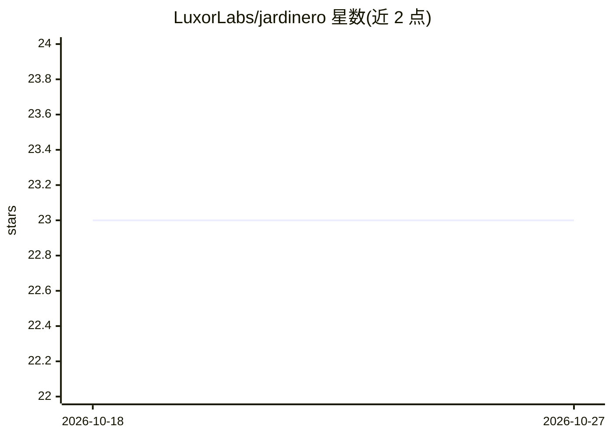

# LuxorLabs/jardinero

⭐ 23 · TypeScript · MIT · 推送 2026-10-26 · [GitHub](https://github.com/LuxorLabs/jardinero) · [官网](https://jardinero.dev) · 组织维护

**常驻自主 AI 工程师：看日志、做工单、维护 PR，产出均回 Pull Request**

Jardinero 是一个自托管的 AI 编排服务，面向希望代理持续维护代码仓库的开发团队。它本身不运行模型 agent，而是编排外部 Codex（ChatGPT 登录或 OpenAI API key）在 Tenki/Freestyle/Daytona 提供的一次性 VM 沙箱中执行任务。功能有三：定时读 Grafana/Loki 遥测并修复错误、实现指派的 Linear 工单、维护 PR 回应评审。工作流为五个状态机，状态存于 SQLite，结果以 PR 交人审阅。需要 Node 24、pnpm、公网 HTTPS 与 GitHub App；每轮运行产生 VM 与 token 费用。

## 筛选速览

| 维度 | 判定 | 备注 |
|---|---|---|
| AI 角色 | `ai-ecosystem` | LLM/agent 周边工具 |
| 许可风险 | `permissive` | MIT |
| 部署形态 | `None` |  |
| 模型依赖 | — | README 未给出锁定关系 |
| 硬件要求 | — | 无带数字的原话,不猜 |
| 安装摩擦 | `medium` | 含编译或系统依赖之一 |
| 成熟度 | — | 结构信号不足 |

## 能力要点

- 三大职责：日志审查（Grafana/Loki）、Linear 工单实现、PR 维护
- 每个任务在 Tenki/Freestyle/Daytona 一次性 VM 沙箱中运行，结果以 PR 返回
- 五个状态机工作流（RequestRouter/LinearImplementer/FixImplementer/PrMaintainer/LogReviewer），状态存 SQLite
- 提供 Compose 单机与 Kubernetes kustomize 两种部署示例，自带运营面板

## 适用场景

- 让常驻 AI 代理监控生产日志并对可确认的错误开出修复 PR
- 把 Linear 工单指派给代理，由其写码、跑测试并提交 PR
- 在 PR 上标记代理，让它回复评审意见、修复失败的检查

## 场景标签

`编码 Agent` `代码审查` · 领域:编码与开发

## 证据(README 行号)

> L32: Jardinero orchestrates agents; it does not run them itself. This is what you have to have; `docs/setup.md` is how t
> L40: |Codex auth|A ChatGPT/Codex login, or an OpenAI API key.|
> L68: Every piece of work is an instance of one of five workflows, each a state machine: **RequestRouter**, **LinearImple

## 星数曲线

2026-10-18 23 → 2026-10-27 23（+0）

---
*卡片 v1 · prompt 1.4 · 生成 2026-10-27 · 置信度 high · 依据 README sha `2382f1af0395` · [字段定义](../../DATASET.md)*
