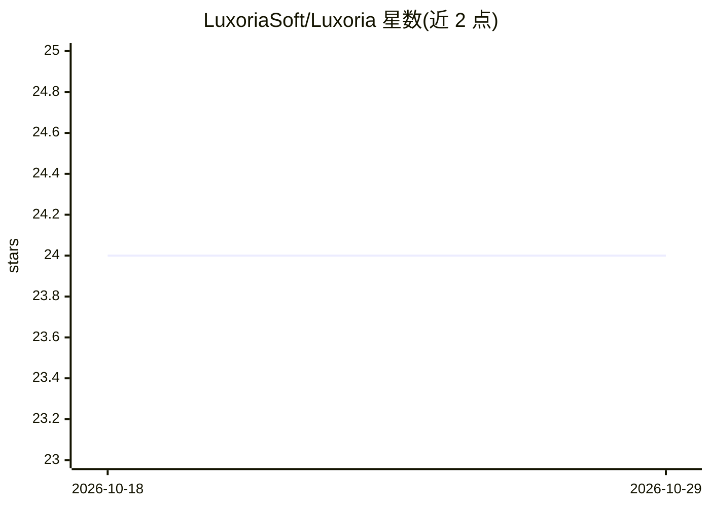

# LuxoriaSoft/Luxoria

⭐ 24 · C# · Apache-2.0 · 推送 2026-05-05 · [GitHub](https://github.com/LuxoriaSoft/Luxoria) · 组织维护

**面向摄影师的一体化照片管理与编辑桌面软件**

面向个人摄影师与团队的摄影工作流软件：桌面应用支持从相机或本地存储导入图片、按相册/合集组织、裁剪/调色/修饰等编辑（含 AI 增强功能），并可导出为 JPEG/PNG/TIFF/PDF 等格式；配套 Web 平台用于向客户分享图库、收集选片与反馈。基于 .NET/WinUI3 构建，采用模块化架构，以 Apache 2.0 许可发布，组件发布于 NuGet。安装方式为从官网下载桌面应用。

## 筛选速览

| 维度 | 判定 | 备注 |
|---|---|---|
| AI 角色 | `ai-enhanced` | 去掉 AI 部分产品仍成立 |
| 许可风险 | `permissive` | Apache-2.0 |
| 部署形态 | `None` |  |
| 模型依赖 | — | README 未给出锁定关系 |
| 硬件要求 | — | 无带数字的原话,不猜 |
| 安装摩擦 | `low` | 无编译、无系统依赖或容器化 |
| 成熟度 | — | 结构信号不足 |

## 能力要点

- 图片导入、相册组织、编辑与多格式导出的桌面应用
- 编辑工具中包含 AI 增强功能
- 配套 Web 平台支持客户选片与实时反馈
- 基于 .NET 生态的模块化架构，包发布于 NuGet

## 适用场景

- 管理并编辑摄影作品库
- 向客户分享图库并收集选片与反馈
- 将成片批量导出为多种交付格式

## 场景标签

`图像视频处理` · 领域:感知与多模态

## 证据(README 行号)

> L24: Luxoria is a powerful all-in-one photography solution designed to streamline your workflow. Whether you are an indi
> L33: - **Edit** with a wide range of powerful editing tools, including AI enhancements.
> L47: - **Editing Tools**: Utilize a variety of editing tools such as cropping, color correction, retouching, and AI-powe

## 星数曲线

2026-10-18 24 → 2026-10-29 24（+0）

---
*卡片 v1 · prompt 1.4 · 生成 2026-10-27 · 置信度 high · 依据 README sha `5c55ad9551bf` · [字段定义](../../DATASET.md)*
