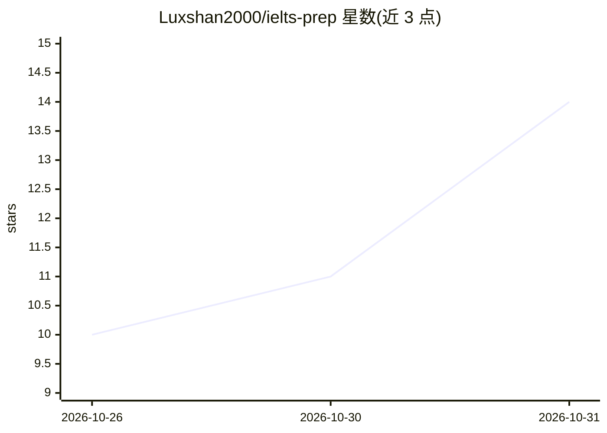

# Luxshan2000/ielts-prep

⭐ 14 · Python · MIT · 推送 2026-09-09 · [GitHub](https://github.com/Luxshan2000/ielts-prep) · 个人维护

**离线优先的雅思全项备考桌面应用，带 AI 语音考官与评分**

Electron 桌面应用加 Python sidecar（仅绑定回环地址），覆盖口语、写作、阅读、听力四项：口语提供 pipecat/WebRTC 实时语音考官，写作生成逐条锚定的批注与范文，听力音频由 Kokoro TTS 本地合成，配自动判分引擎。用户自选一个 LLM、一个 STT、一个 TTS（本地 Ollama 或云端 OpenRouter 等预设），模型权重不随包分发、首次运行下载约 340MB。无账号、无遥测，录音与成绩保存在本地。当前支持安装方式为从源码构建，需 Node.js 20、Python 3.11、pnpm、uv。分数为 AI 生成的练习估计值，非官方预测。

## 筛选速览

| 维度 | 判定 | 备注 |
|---|---|---|
| AI 角色 | `ai-native` | 本体是模型或模型工具 |
| 许可风险 | `permissive` | MIT |
| 部署形态 | `library` | 以包/库形式分发 |
| 模型依赖 | local-ok | 支持本地模型 |
| 硬件要求 | — | 无带数字的原话,不猜 |
| 安装摩擦 | `low` | 无编译、无系统依赖或容器化 |
| 成熟度 | — | 结构信号不足 |

## 能力要点

- 实时 WebRTC 语音考官（pipecat、Silero VAD），每场口语出四项评分报告与逐句音频回放
- 写作逐错误字符级锚定批注，附 band 8/9 范文对照
- 听力音频由 Kokoro TTS 按角色与口音本地合成后缓存，测试以脚本而非音频分发
- 模型与 API key 均不随包分发，sidecar 仅绑回环并需每次启动的 bearer token

## 适用场景

- 在本机离线进行雅思四项全真模拟练习
- 和 AI 语音考官进行口语对话并获得逐项评分
- 选择本地或云端模型批改作文与录音

## 场景标签

`语音 Agent` · 领域:对话与助手

## 证据(README 行号)

> L7:  Offline-first IELTS exam preparation for your own machine.
> L31: IELTS Prep is an exam room, not a chatbot wrapper. You get authentic question formats, real
> L49: - **A live voice examiner** — real-time WebRTC conversation over pipecat 1.5, SmallWebRTCTransport and Silero VAD. 

## 星数曲线

2026-10-26 10 → 2026-10-31 14（+4）

---
*卡片 v1 · prompt 1.4 · 生成 2026-10-31 · 置信度 mid · 依据 README sha `c5fd2339b29e` · [字段定义](../../DATASET.md)*
