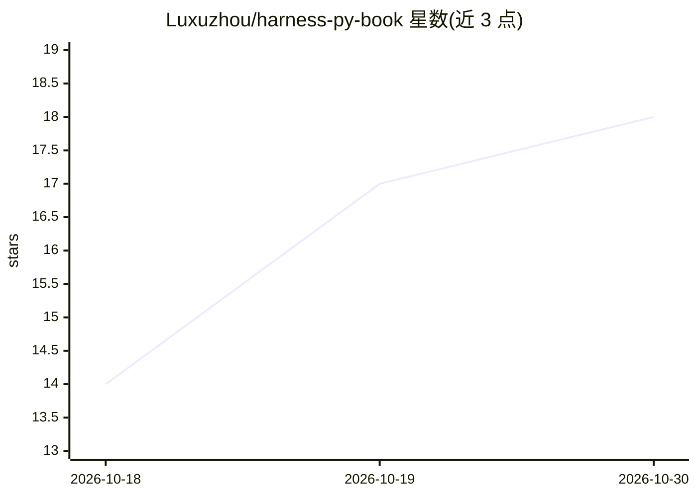

# Luxuzhou/harness-py-book

⭐ 18 · Python · MIT · 推送 2026-07-16 · [GitHub](https://github.com/Luxuzhou/harness-py-book) · 个人维护 · 中文 README

**AI Agent 可靠性工程书籍的配套代码仓库（12 章双层实现）**

《Harness Engineering实战：构建可靠的生产级AI Agent》一书的配套代码仓库，含教学层 harness_py/ 与生产层 harness_py_pro/ 双层实现，按约束、工具、上下文、记忆、验证、编排六层架构组织，覆盖第 1—12 章、3 个企业级案例（Java 重构、医疗数据合规、多 Agent 集成）与 226 项自动化测试。模型调用采用 OpenAI 兼容协议，支持 DeepSeek、通义千问、Kimi、GLM 等服务；教学层保持轻依赖，不要求 LangChain 等框架。案例代码为实验基线而非可部署的生产系统。

## 筛选速览

| 维度 | 判定 | 备注 |
|---|---|---|
| AI 角色 | `ai-knowledge` | 知识聚合/清单类 |
| 许可风险 | `permissive` | MIT |
| 部署形态 | `library` | 以包/库形式分发 |
| 模型依赖 | — | README 未给出锁定关系 |
| 硬件要求 | — | 无带数字的原话,不猜 |
| 安装摩擦 | `low` | 无编译、无系统依赖或容器化 |
| 成熟度 | — | 结构信号不足 |

## 能力要点

- 教学层 + 生产层双层实现，覆盖 12 章
- 约束→工具→上下文→记忆→验证→编排的六层参考架构
- 3 个企业级案例：Java 重构、医疗数据合规、跨语言多 Agent
- 226 项自动化测试，多数示例无需 API Key 即可运行

## 适用场景

- 按章节边读书边运行最小示例与实验
- 复现企业级 Agent 实战案例（Java 重构/数据合规/多 Agent）
- 学习生产级 Agent 的约束、沙箱与验证机制实现

## 场景标签

`教程课程` · 领域:学习与行业

## 证据(README 行号)

> L1: 《Harness Engineering实战：构建可靠的生产级AI Agent》配套代码仓库
> L9:  从教学框架到生产内核，用可运行代码讲透约束、工具、上下文、记忆、验证与多 Agent 编排。
> L26: |`harness_py/` 教学层逐步实现核心机制|`experiments/` 提供章节对照实验与结果|Java 重构、医疗合规、跨语言多 Agent|

## 星数曲线

2026-10-18 14 → 2026-10-30 18（+4）

---
*卡片 v1 · prompt 1.4 · 生成 2026-10-30 · 置信度 mid · 依据 README sha `a2e095e45f94` · [字段定义](../../DATASET.md)*
