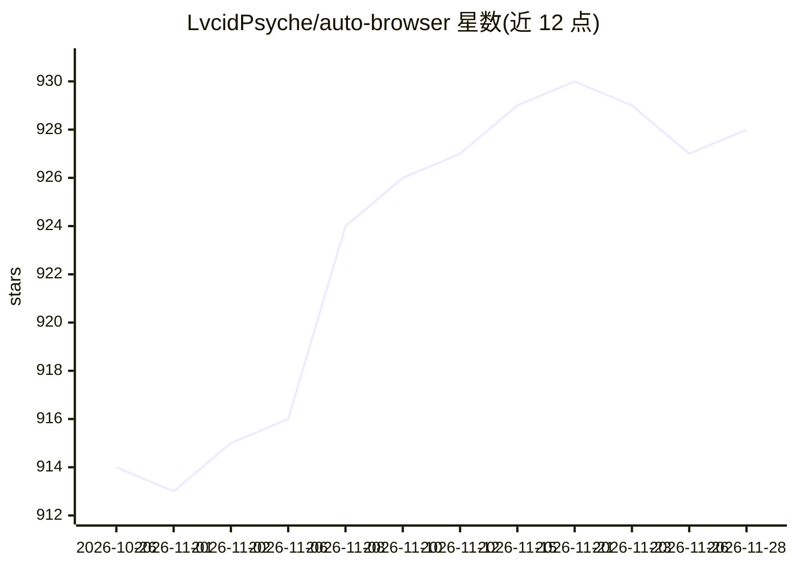

# LvcidPsyche/auto-browser

⭐ 928 · Python · MIT · 推送 2026-11-26 · [GitHub](https://github.com/LvcidPsyche/auto-browser) · [官网](https://github.com/LvcidPsyche/auto-browser) · 个人维护

**给 MCP 客户端和 LLM agent 提供可人工接管的共享浏览器**

MCP 原生的浏览器控制平面：通过 HTTP 或 stdio 向 MCP 客户端、LLM agent 与运维人员提供共享的 Playwright 浏览器会话，附带人工接管（noVNC）、可复用登录凭证档案、审批门、审计事件、PII 清洗与 Ed25519 签名的 Witness 凭证链。默认本地优先，用 Docker Compose 一键起全栈；MCP 工具按 curated/lean/full 档位分级暴露（默认 20 个工具），并内置 Stage 0 收敛 harness 用于技能归纳。明确不做验证码破解与未授权抓取。

## 筛选速览

| 维度 | 判定 | 备注 |
|---|---|---|
| AI 角色 | `ai-ecosystem` | LLM/agent 周边工具 |
| 许可风险 | `permissive` | MIT |
| 部署形态 | `self-host` | docker 或自建部署 |
| 模型依赖 | — | README 未给出锁定关系 |
| 硬件要求 | — | 无带数字的原话,不猜 |
| 安装摩擦 | `low` | 无编译、无系统依赖或容器化 |
| 成熟度 | — | 结构信号不足 |

## 能力要点

- MCP over HTTP + stdio 桥接（uvx auto-browser-mcp），兼容任意 MCP 客户端与 REST 直调
- noVNC 人工接管、审批门、操作者身份头与审计事件等安全机制
- 命名 auth profile：登录一次，新会话免重复认证
- Ed25519 签名的 Witness 凭证链，导出包可用独立脚本验证

## 适用场景

- 让 Claude Code / Codex 等 MCP 客户端操作真实浏览器执行任务
- 内部后台与运维工具的 operator 辅助 QA 与浏览器调试
- 登录一次后在新会话中复用已认证状态
- 脆弱站点流程中由人随时接管恢复

## 场景标签

`浏览器自动化` · 领域:效率与自动化

## 证据(README 行号)

> L20: Auto Browser is an MCP-native browser control plane for authorized workflows. It gives MCP clients, LLM agents, and
> L32: - **MCP-native from day one.** The browser surface is already packaged as an MCP server instead of bolted on after 
> L47: - MCP-powered agent workflows that need a real browser, not just HTML fetches

## 星数曲线

2026-10-26 914 → 2026-11-28 928（+14）

---
*卡片 v1 · prompt 1.4 · 生成 2026-11-26 · 置信度 high · 依据 README sha `65650492dd68` · [字段定义](../../DATASET.md)*
