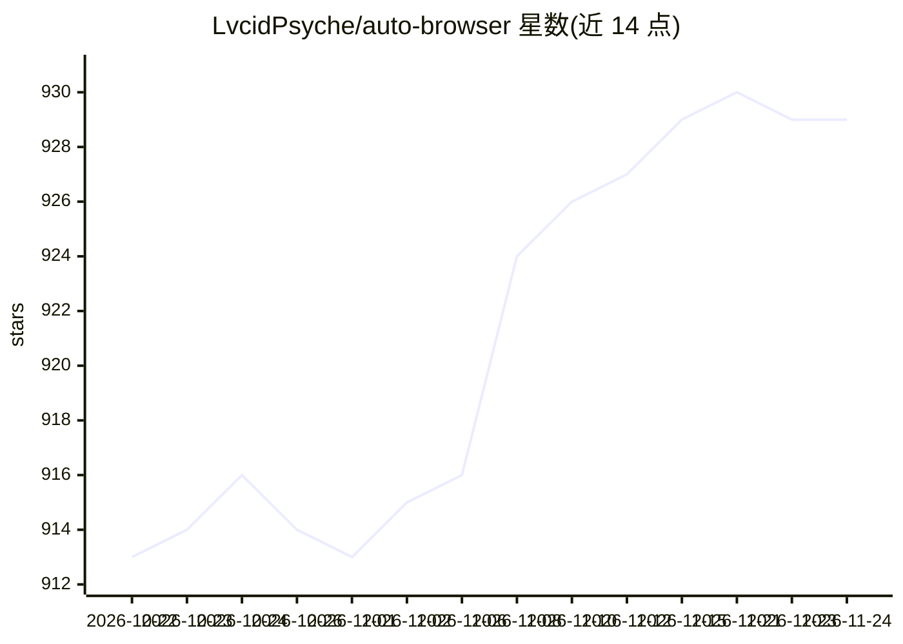

# LvcidPsyche/auto-browser

⭐ 929 · Python · MIT · 推送 2026-11-23 · [GitHub](https://github.com/LvcidPsyche/auto-browser) · [官网](https://github.com/LvcidPsyche/auto-browser) · 个人维护

**给 MCP 客户端与 LLM Agent 提供带人工接管的真实浏览器控制层**

MCP 原生的浏览器控制平面：向 MCP 客户端、LLM Agent 与运维人员共享一个 Playwright 浏览器，提供人工接管（noVNC）、可复用登录态（auth profiles）、审批门、审计事件、PII 清洗与 Ed25519 签名的 Witness 证据链。通过 HTTP MCP 端点、stdio 桥或 REST API 暴露 7/20/全量可配置的工具档位，Docker Compose 本地部署，并内置 Stage 0 技能归纳收敛 harness。明确声明不做 CAPTCHA 破解与未授权抓取。

## 筛选速览

| 维度 | 判定 | 备注 |
|---|---|---|
| AI 角色 | `ai-ecosystem` | LLM/agent 周边工具 |
| 许可风险 | `permissive` | MIT |
| 部署形态 | `self-host` | docker 或自建部署 |
| 模型依赖 | — | README 未给出锁定关系 |
| 硬件要求 | — | 无带数字的原话,不猜 |
| 安装摩擦 | `low` | 无编译、无系统依赖或容器化 |
| 成熟度 | — | 结构信号不足 |

## 能力要点

- MCP over HTTP、stdio 桥（uvx auto-browser-mcp）与 REST 三种接入方式
- noVNC 人工接管与登录一次、复用会话的 auth profiles
- 审批门、操作员身份、PII 清洗与 Ed25519 签名 Witness 收据链
- MCP_TOOL_PROFILE 可配置 7 工具精简档 / 20 工具精选档 / 全量档

## 适用场景

- 让 Claude Code / Cursor 等 MCP 客户端操作真实浏览器完成网页任务
- 需要人工介入恢复的脆弱网站流程与运维辅助 QA
- 登录一次后在后续自动化会话中复用账号状态
- 内部后台与管理系统中的 Agent 浏览器工作流

## 场景标签

`浏览器自动化` · 领域:效率与自动化

## 证据(README 行号)

> L20: Auto Browser is an MCP-native browser control plane for authorized workflows. It gives MCP clients, LLM agents, and
> L32: - **MCP-native from day one.** The browser surface is already packaged as an MCP server instead of bolted on after 
> L35: - **Local-first by default.** Run the full stack on your own box with Docker Compose, or use Codespaces for a quick

## 星数曲线

2026-10-22 913 → 2026-11-24 929（+16）

---
*卡片 v1 · prompt 1.4 · 生成 2026-11-24 · 置信度 high · 依据 README sha `9b8361f96878` · [字段定义](../../DATASET.md)*
