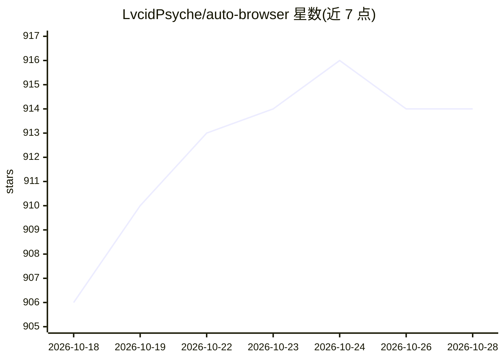

# LvcidPsyche/auto-browser

⭐ 914 · Python · MIT · 推送 2026-10-27 · [GitHub](https://github.com/LvcidPsyche/auto-browser) · [官网](https://github.com/LvcidPsyche/auto-browser) · 个人维护

**MCP 原生浏览器控制平面：让 AI agent 带人工接管地操作真实浏览器**

面向 MCP 客户端、LLM agent 与操作者的自托管浏览器控制层：提供共享 Playwright 浏览器会话（截图、DOM 摘要、OCR、标签与网络检查），配合 noVNC 人工接管、命名认证配置复用登录、审批门禁、审计事件、PII 清洗与 Ed25519 签名的 Witness 回执链。通过 MCP over HTTP、stdio 桥或 REST API 接入，Docker Compose 一键部署，默认端口绑定 127.0.0.1。明确不支持 CAPTCHA 破解与未授权抓取。附 Agent 技能归纳收敛测试装置与合规预设模板。

## 筛选速览

| 维度 | 判定 | 备注 |
|---|---|---|
| AI 角色 | `ai-ecosystem` | LLM/agent 周边工具 |
| 许可风险 | `permissive` | MIT |
| 部署形态 | `self-host` | docker 或自建部署 |
| 模型依赖 | — | README 未给出锁定关系 |
| 硬件要求 | — | 无带数字的原话,不猜 |
| 安装摩擦 | `low` | 无编译、无系统依赖或容器化 |
| 成熟度 | — | 结构信号不足 |

## 能力要点

- Playwright 会话 + noVNC 人工接管共享同一活会话
- 命名认证配置实现登录一次、后续会话复用
- 审批门禁、操作者身份、PII 清洗与 Ed25519 签名 Witness 回执链
- MCP over HTTP / stdio 桥 / REST API 三种接入方式，Docker Compose 部署

## 适用场景

- 给 MCP agent 提供带人工接管的真实浏览器环境
- 登录一次后让 agent 复用已认证会话处理内部系统
- 需要审批与审计留痕的浏览器自动化工作流

## 场景标签

`浏览器自动化` · 领域:效率与自动化

## 证据(README 行号)

> L20: Auto Browser is an MCP-native browser control plane for authorized workflows. It gives MCP clients, LLM agents, and
> L32: - **MCP-native from day one.** The browser surface is already packaged as an MCP server instead of bolted on after 

## 星数曲线

2026-10-18 906 → 2026-10-28 914（+8）

---
*卡片 v1 · prompt 1.4 · 生成 2026-10-21 · 置信度 high · 依据 README sha `983a44404a49` · [字段定义](../../DATASET.md)*
