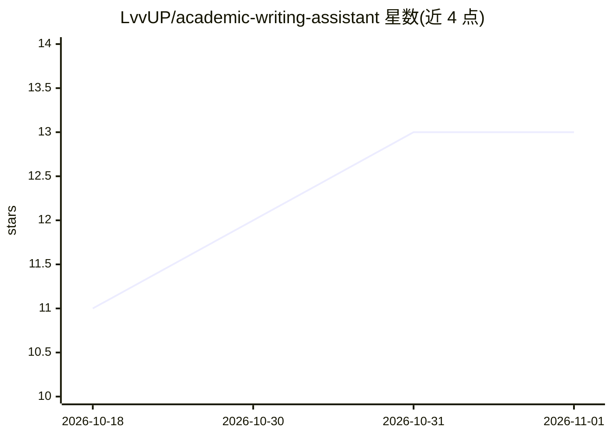

# LvvUP/academic-writing-assistant

⭐ 13 · Python · AGPL-3.0 · 推送 2026-10-02 · [GitHub](https://github.com/LvvUP/academic-writing-assistant) · 组织维护 · 中文 README

**面向中文科研作者的通用学术写作 Agent Skill，保真润色不改数据**

以提示词包（SKILL）形式分发的学术写作技能，安装到 Claude Code、Codex、Cursor、Grok Build、OpenCode 五种 Agent 后使用，覆盖论文润色、中英互译、章节起草、学位论文与基金申请、审稿回复与投稿材料。核心机制是保真契约：数值/引用/公式列为锁定区原样保留，主张强度修改须单独列入台账，缺失信息用占位标记而非编造。内置 12 个学科大类提示与仅用标准库的本地核查脚本；安装通过仓库自带 Python 脚本（需 Git 与 Python 3.9+）完成，不提供降低 AI 检测率服务。

## 筛选速览

| 维度 | 判定 | 备注 |
|---|---|---|
| AI 角色 | `ai-native` | 本体是模型或模型工具 |
| 许可风险 | `viral` | AGPL-3.0 |
| 部署形态 | `None` |  |
| 模型依赖 | locked-api |  |
| 硬件要求 | — | 无带数字的原话,不猜 |
| 安装摩擦 | `low` | 无编译、无系统依赖或容器化 |
| 成熟度 | — | 结构信号不足 |

## 能力要点

- 保真契约：锁定区原样保留、承重语言修改须列台账（L1/L2/L3 分级）
- 支持 5 种 Agent 宿主（Claude Code、Codex、Cursor、Grok Build、OpenCode）
- 覆盖润色/互译/起草/学位论文与基金申请/审稿回复/投稿材料等任务
- 4 个本地 Python 核查脚本（数值引用比对、缩写与术语一致性等），仅标准库、不联网

## 适用场景

- 润色论文时确保数值、引用与结论范围不被 AI 悄悄改动
- 撰写中译英摘要、审稿回复信与投稿 Cover letter 等材料
- 按学科惯例起草学位论文章节或基金申请书

## 场景标签

`提示工程` `AI 写作` · 领域:Agent 开发

## 证据(README 行号)

> L7: 面向中文科研作者的**通用学术写作 Skill**：论文润色 · 中英互译 · 章节起草 · 学位论文与基金申请 · 审稿回复 · 投稿材料
> L8: 适用于理工、医学、经管、社科、人文、法学等各学科，一份 Skill 可在 Claude Code、Codex、Cursor、Grok Build、OpenCode 中使用。

## 星数曲线

2026-10-18 11 → 2026-11-01 13（+2）

---
*卡片 v1 · prompt 1.4 · 生成 2026-10-31 · 置信度 high · 依据 README sha `fa51407f91cf` · [字段定义](../../DATASET.md)*
