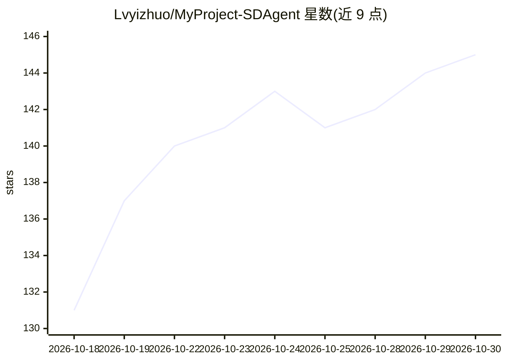

# Lvyizhuo/MyProject-SDAgent

⭐ 145 · Java · 推送 2026-10-29 · [GitHub](https://github.com/Lvyizhuo/MyProject-SDAgent) · [官网](http://mmgg.dpdns.org/login) · 个人维护 · 中文 README

**山东省政策咨询的 RAG 多智能体问答平台**

基于 Spring Boot 3.4.1 + Spring AI 1.0.3 + React 19 构建的前后端分离智能知识库问答系统，面向山东省以旧换新政策场景，提供政策问答（RAG）、补贴测算、多模态识别（语音/图片/发票/设备）以及含多智能体、知识库、工具、模型四模块的管理员控制台。模型路由支持 DashScope 默认与 OpenAI 兼容第三方模型，嵌入用 Ollama 本地 bge-m3，重排序为自建 FastAPI 服务，基础设施含 PostgreSQL+pgvector、Redis、MinIO，支持 Docker Compose 与宝塔一键部署。

## 筛选速览

| 维度 | 判定 | 备注 |
|---|---|---|
| AI 角色 | `ai-native` | 本体是模型或模型工具 |
| 许可风险 | `none` | — |
| 部署形态 | `self-host` | docker 或自建部署 |
| 模型依赖 | local-ok | 支持本地模型 |
| 硬件要求 | — | 无带数字的原话,不猜 |
| 安装摩擦 | `low` | 无编译、无系统依赖或容器化 |
| 成熟度 | — | 结构信号不足 |

## 能力要点

- RAG 政策问答与补贴测算核心闭环
- 多智能体实例管理，各可独立绑定 LLM/视觉/语音/嵌入/重排序模型
- 知识库管理含文档上传、网站导入、切片预览与归档导入导出
- Docker Compose / 宝塔 deploy.sh 一键部署

## 适用场景

- 政府部门或公共服务平台承接高频政策咨询
- 按地区、品类、价格测算以旧换新补贴
- 识别发票、设备信息辅助补贴申请
- 管理员统一配置多个智能体与知识库

## 场景标签

`文档问答` `RAG` `多智能体` `多模态` · 领域:Agent 开发

## 证据(README 行号)

> L21: 基于 AI/LLM 的山东省以旧换新政策咨询系统，支持政策问答、补贴计算、多模态识别，以及管理员控制台中的多智能体配置、知识库管理和模型服务管理。
> L29: - 政策问答：基于 RAG 检索增强，提供结构化、可追溯的政策解答。
> L31: - 多模态识别：支持语音转写、图片/设备/发票识别。

## 星数曲线

2026-10-18 131 → 2026-10-30 145（+14）

---
*卡片 v1 · prompt 1.4 · 生成 2026-10-22 · 置信度 mid · 依据 README sha `c5c93024f279` · [字段定义](../../DATASET.md)*
