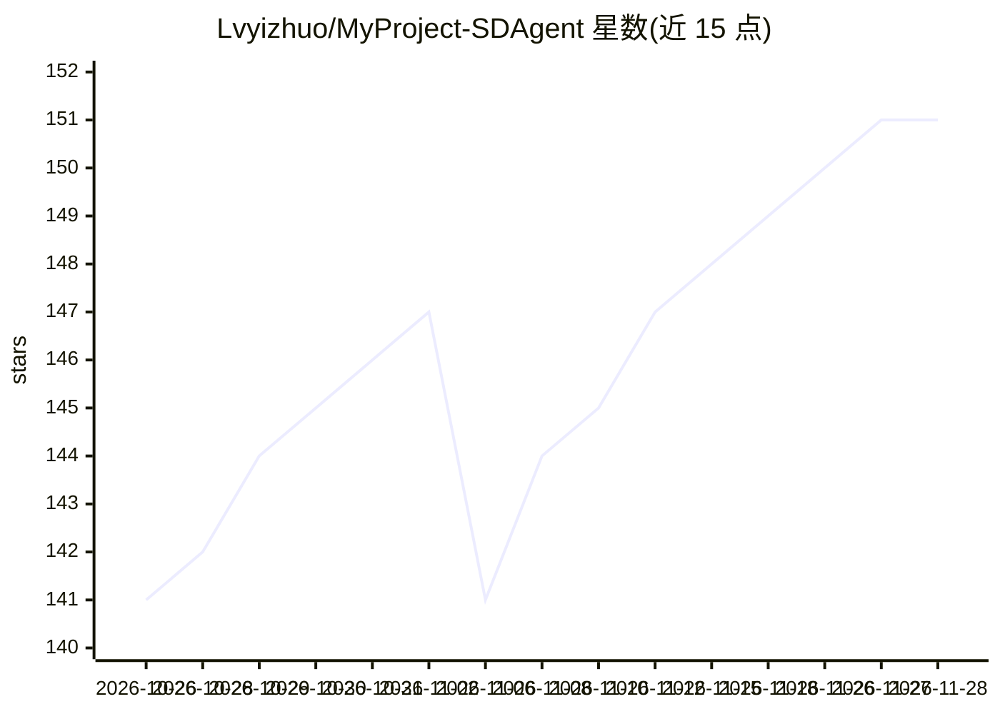

# Lvyizhuo/MyProject-SDAgent

⭐ 151 · Java · 推送 2026-11-16 · [GitHub](https://github.com/Lvyizhuo/MyProject-SDAgent) · [官网](http://mmgg.dpdns.org/login) · 个人维护 · 中文 README

**面向山东政策咨询场景的 RAG 多智能体问答系统**

基于 Spring Boot 3 + Spring AI 构建的山东省以旧换新政策咨询系统：政策 RAG 问答、补贴测算、语音/图片/发票/设备多模态识别，附带管理员控制台，支持多智能体实例创建与独立配置模型绑定、系统提示词、技能开关，以及 LLM/视觉/语音/嵌入/重排序五类模型统一管理。部署依赖 Java 21、Node.js 18、Docker，需配置 DashScope API Key；默认嵌入模型经 Ollama 本地部署，另有自建 Python 重排序服务。

## 筛选速览

| 维度 | 判定 | 备注 |
|---|---|---|
| AI 角色 | `ai-native` | 本体是模型或模型工具 |
| 许可风险 | `none` | — |
| 部署形态 | `self-host` | docker 或自建部署 |
| 模型依赖 | local-ok | 支持本地模型 |
| 硬件要求 | — | 无带数字的原话,不猜 |
| 安装摩擦 | `low` | 无编译、无系统依赖或容器化 |
| 成熟度 | — | 结构信号不足 |

## 能力要点

- RAG 政策问答与补贴测算，问答结构化、可追溯
- 多智能体管理：每个实例独立绑定模型、提示词与技能开关
- 五类模型（LLM/视觉/语音/嵌入/重排序）统一管理与连接测试
- 扫描版 PDF 提取失败时走视觉 OCR 兜底

## 适用场景

- 搭建政务政策咨询与解读的知识库问答系统
- 管理部门为多个业务场景配置独立智能体并绑定模型
- 通过控制台上传文档或导入网站构建政策知识库
- 语音接待、发票与设备识别等多模态业务接入

## 场景标签

`文档问答` `RAG` `多智能体` `多模态` · 领域:Agent 开发

## 证据(README 行号)

> L7:  面向山东省政策场景，基于 RAG + 多智能体技术构建的"全链路"智能知识库问答系统
> L29: - 政策问答：基于 RAG 检索增强，提供结构化、可追溯的政策解答。
> L48: |大模型|阿里云 DashScope（聊天默认 `qwen3.5-plus`，支持管理员绑定第三方 OpenAI 兼容模型）|

## 星数曲线

2026-10-26 141 → 2026-11-28 151（+10）

---
*卡片 v1 · prompt 1.4 · 生成 2026-11-27 · 置信度 high · 依据 README sha `4a185eeb78c2` · [字段定义](../../DATASET.md)*
