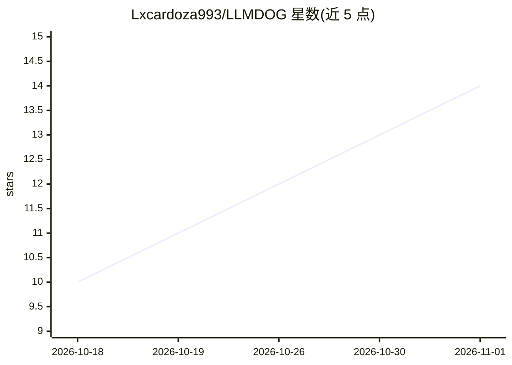

# Lxcardoza993/LLMDOG

⭐ 14 · Python · MIT · 推送 2026-10-30 · [GitHub](https://github.com/Lxcardoza993/LLMDOG) · 个人维护 · 中文 README

**LLM 驱动的本机服务看门狗：探活、诊断、自动修复**

面向 homelab/自托管用户的本地服务监控守护工具：systemd timer 每 2 分钟以 HTTP 或 shell 命令探活，失败后收集日志/systemctl/journalctl 等诊断数据交给本地 LLM 生成 JSON 修复方案，经二次确认、白名单、可回滚、危险命令黑名单四道护栏后执行并验证。反复出现≥3 次的 bug 会提炼为 known_issue 写入监控实现复发自愈。提供 Telegram 通知，默认 DRY_RUN 假执行模式，另含 fixed_rule 与 alert 两种不依赖 LLM 的模式。通过 git clone 源码安装配置。

## 筛选速览

| 维度 | 判定 | 备注 |
|---|---|---|
| AI 角色 | `ai-native` | 本体是模型或模型工具 |
| 许可风险 | `permissive` | MIT |
| 部署形态 | `None` |  |
| 模型依赖 | — | README 未给出锁定关系 |
| 硬件要求 | — | 无带数字的原话,不猜 |
| 安装摩擦 | `low` | 无编译、无系统依赖或容器化 |
| 成熟度 | — | 结构信号不足 |

## 能力要点

- 探活失败后由本地 LLM 分析诊断数据生成 JSON 修复方案
- 四道护栏：二次 LLM 确认/白名单最小改动/可回滚/危险命令黑名单
- 复发达 3 次的 bug 自动提炼为 known_issue，复发时自愈
- 默认 DRY_RUN 假执行，另提供 fixed_rule 与 alert 两种模式

## 适用场景

- 自托管/homelab 服务的无人值守监控与自动修复
- 半夜服务挂掉时希望工具自动诊断处理而非人工 SSH
- 对不可自动修复的服务仅做探活与 Telegram 告警

## 场景标签

 · 领域:运维/监控

## 证据(README 行号)

> L4: > An LLM-powered local-service watchdog: probe → diagnose with LLM → guardrail → fix → verify → self-heal. It even *
> L21: - 🧠 **LLM root-cause analysis** — feeds diagnostics (logs / `systemctl` / `journalctl` / ports / `ps`) to a local L

## 星数曲线

2026-10-18 10 → 2026-11-01 14（+4）

---
*卡片 v1 · prompt 1.4 · 生成 2026-10-31 · 置信度 high · 依据 README sha `2ca79e458524` · [字段定义](../../DATASET.md)*
