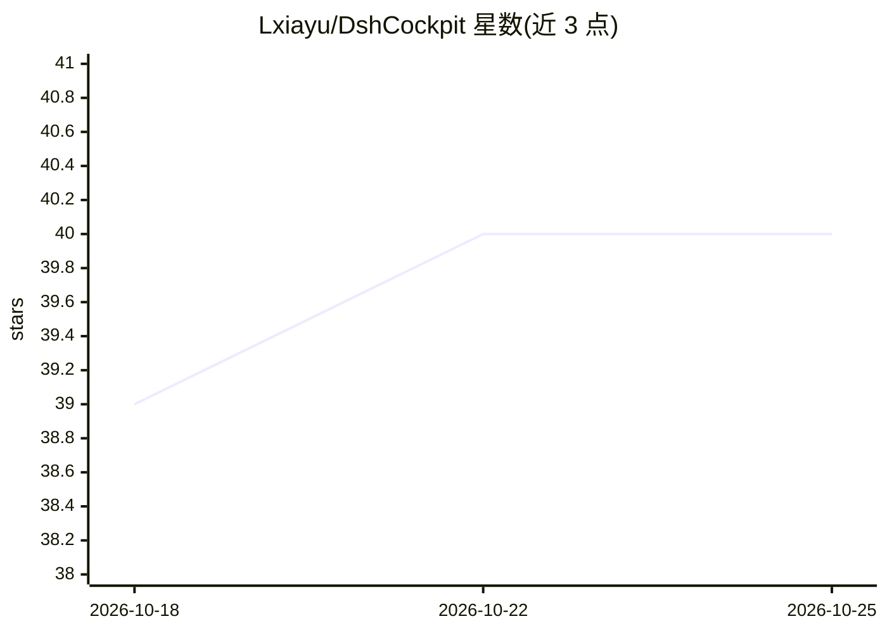

# Lxiayu/DshCockpit

⭐ 40 · JavaScript · MIT · 推送 2026-10-24 · [GitHub](https://github.com/Lxiayu/DshCockpit) · [官网](dshcockpit.site) · 个人维护 · 中文 README

**DeepSeek Harness 的桌面驾驶舱：监控 Agent 团队用量成本**

DeepSeek Harness（dsh）的开源桌面壳（Electron），提供原生会话工作台、虚拟办公室可视化（调度员/研究员/编码员等角色随运行状态变化）、Token 用量与费用统计、预算提醒、运行时更新与回滚、Quick Ask 热键、定时任务、会话检索与按需手机远程访问。安装包内置运行时，无需单独安装 Node.js。面向 Windows x64 与 macOS arm64，macOS 包为 ad-hoc 签名未做公证；核心代码 MIT，美术素材另有授权。与 DeepSeek 官方无隶属关系。

## 筛选速览

| 维度 | 判定 | 备注 |
|---|---|---|
| AI 角色 | `ai-ecosystem` | LLM/agent 周边工具 |
| 许可风险 | `permissive` | MIT |
| 部署形态 | `desktop` | 安装包/桌面程序 |
| 模型依赖 | locked-api |  |
| 硬件要求 | — | 无带数字的原话,不猜 |
| 安装摩擦 | `low` | 无编译、无系统依赖或容器化 |
| 成熟度 | `idea` | |

## 能力要点

- Token 用量、上下文压力、成本统计与预算提醒
- 运行时更新检查、切换与数据快照回滚
- 虚拟办公室以角色状态可视化 Agent 团队与待处理审批事项
- 安装包内置运行时，无需单独安装 Node.js

## 适用场景

- 桌面端监控 DeepSeek Harness agent 的成本与用量并接收预算提醒
- 通过办公室视图跟进 agent 任务进展并处理待审批事项
- 用 Quick Ask 与定时任务在后台交代和跟踪任务
- 检索历史会话并按需配置手机远程访问

## 场景标签

`LLM 可观测性` · 领域:评测与运维

## 证据(README 行号)

> L23: DshCockpit 是 DeepSeek Harness 的开源桌面壳，把原生会话工作台、常驻运行能力和一个鲜活的虚拟办公室放在一起。
> L30: - **掌握用量**：办公室侧栏展示今日 Token 和费用估算；详细成本与上下文工具继续由驾驶舱提供。
> L56: |成本与上下文|Token 用量、上下文压力、成本统计和预算提醒|

## 星数曲线

2026-10-18 39 → 2026-10-25 40（+1）

---
*卡片 v1 · prompt 1.4 · 生成 2026-10-25 · 置信度 high · 依据 README sha `7ce5d4add04a` · [字段定义](../../DATASET.md)*
