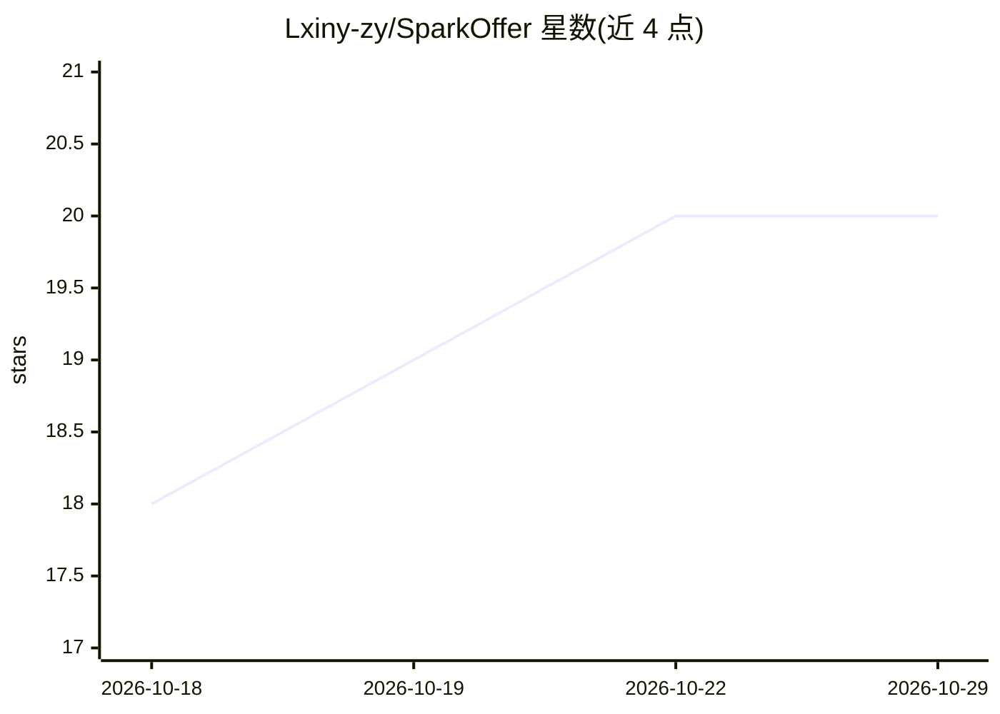

# Lxiny-zy/SparkOffer

⭐ 20 · Python · 推送 2026-08-19 · [GitHub](https://github.com/Lxiny-zy/SparkOffer) · 个人维护 · 中文 README

**面向技术岗求职者的 AI 面试训练系统：跨会话能力建模闭环**

面向技术岗求职者的 AI 面试训练系统，FastAPI 后端 + React 19 前端。核心机制是在每轮出题前融合长期画像、领域掌握度等三层上下文；训练后逐题打分、以确定性算法更新掌握度、用 LLM 按 Mem0 风格（ADD/UPDATE/IMPROVE）合并画像、向量化入库，并按 SM-2 遗忘曲线调度复习。提供六个训练入口（弱点狙击、实战模拟、岗位特训等），RAG 基于用户自维护 Markdown 知识库与历史训练记忆。需配置任意 OpenAI 兼容 LLM 与 Embedding API；支持 Docker Compose 部署与手动启动，生产模式有安全配置校验。

## 筛选速览

| 维度 | 判定 | 备注 |
|---|---|---|
| AI 角色 | `ai-native` | 本体是模型或模型工具 |
| 许可风险 | `none` | — |
| 部署形态 | `self-host` | docker 或自建部署 |
| 模型依赖 | — | README 未给出锁定关系 |
| 硬件要求 | — | 无带数字的原话,不猜 |
| 安装摩擦 | `low` | 无编译、无系统依赖或容器化 |
| 成熟度 | — | 结构信号不足 |

## 能力要点

- 三层上下文融合的个性化出题引擎，难度随掌握度（0-100）自适应
- 训练→评估→画像更新闭环：确定性掌握度算法 + LLM 画像合并 + 向量化记忆
- 双层 RAG：LlamaIndex 索引用户 Markdown 知识库 + 历史训练记忆语义召回
- SM-2 遗忘曲线复习调度，掌握度雷达图与趋势图等成长可视化

## 适用场景

- 围绕自己的简历项目和目标 JD 做定向面试训练
- 长期跟踪薄弱点与能力曲线，而非一次性刷题问答
- 把自维护的技术笔记变成出题与评分依据的知识库
- 按遗忘曲线安排知识点复习

## 场景标签

`RAG` · 领域:知识与检索

## 证据(README 行号)

> L15: SparkOffer 是一个面向技术岗求职者的 **AI 面试训练系统**。
> L43:      → LLM 画像更新（Mem0 风格的 ADD / UPDATE / IMPROVE）
> L64: - **领域知识库**：LlamaIndex 索引你自己维护的 Markdown 知识文档，作为出题与评分的事实依据

## 星数曲线

2026-10-18 18 → 2026-10-29 20（+2）

---
*卡片 v1 · prompt 1.4 · 生成 2026-10-28 · 置信度 high · 依据 README sha `38f812ef23e1` · [字段定义](../../DATASET.md)*
