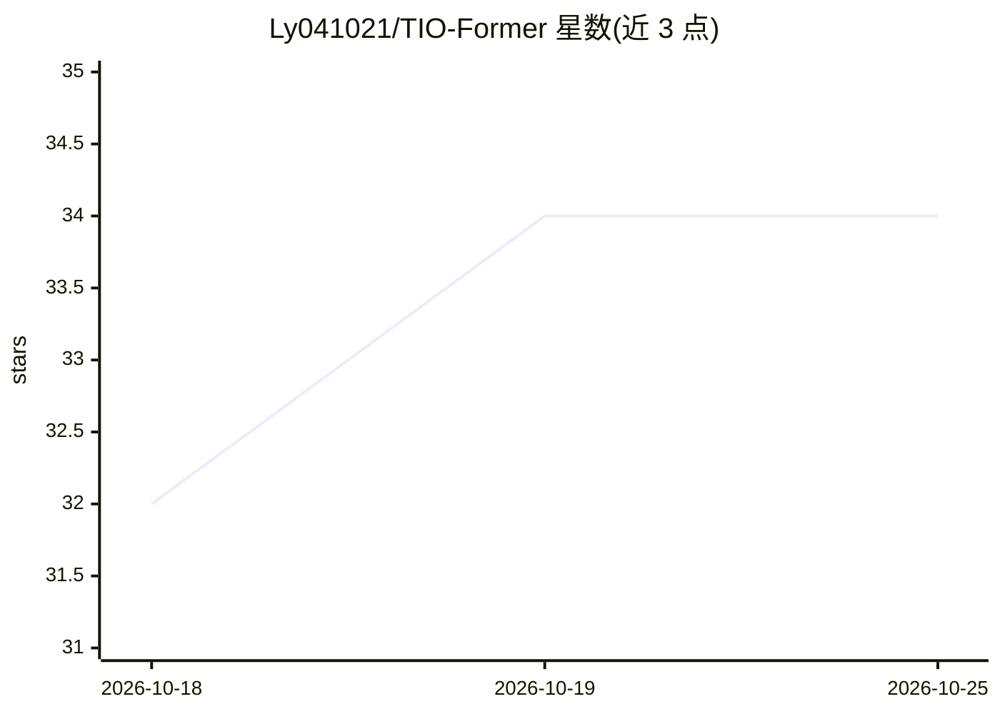

# Ly041021/TIO-Former

⭐ 34 · 推送 2026-09-28 · [GitHub](https://github.com/Ly041021/TIO-Former) · [官网](https://arxiv.org/abs/2609.17198) · 组织维护 · 中文 README

**面向纳米无人机的六向 ToF-惯性轻量里程计框架（论文先行）**

浙江大学团队发布的 TIO-Former：基于流式因果 Transformer 的无相机、无光流、无地图距离-惯性里程计框架，输入六路正交 8×8 ToF 阵列与同步 IMU 数据，输出连续 6-DoF 位姿估计；采用可靠性感知 ToF 编码、IMU 引导的方向融合与有界流式内存，面向资源受限的纳米无人机。目前仅 arXiv 论文可获取，训练/评测代码、预训练模型与数据集均标注 Coming soon，尚未发布。

## 筛选速览

| 维度 | 判定 | 备注 |
|---|---|---|
| AI 角色 | `ai-native` | 本体是模型或模型工具 |
| 许可风险 | `none` | — |
| 部署形态 | `None` |  |
| 模型依赖 | — | README 未给出锁定关系 |
| 硬件要求 | — | 无带数字的原话,不猜 |
| 安装摩擦 | `low` | 无编译、无系统依赖或容器化 |
| 成熟度 | `idea` | |

## 能力要点

- 六向 8×8 ToF（每帧 384 个测距值）+ IMU 输入的 6-DoF 里程计
- 15 Hz 在线推理，P95 边缘延迟 10.466 ms，传感器负载 15 g
- 局部 KV 与压缩 Chunk-FIFO 内存保证长时飞行的固定单步开销

## 适用场景

- 纳米无人机在无相机/无光流条件下做实时位姿估计
- 资源受限边缘设备上的长时程导航
- 作为 ToF-惯性里程计研究的复现与对比基线（待代码发布）

## 场景标签

 · 领域:机器人/无人机状态估计

## 证据(README 行号)

> L19: TIO-Former is a camera-free, optical-flow-free, and mapless range-inertial odometry framework for resource-constrai
> L3: ### Ultra-Lightweight 6-Directional ToF-Inertial Odometry for Nano-UAVs via a Streaming Causal Transformer

## 星数曲线

2026-10-18 32 → 2026-10-25 34（+2）

---
*卡片 v1 · prompt 1.4 · 生成 2026-10-25 · 置信度 mid · 依据 README sha `9fc9b208e37d` · [字段定义](../../DATASET.md)*
