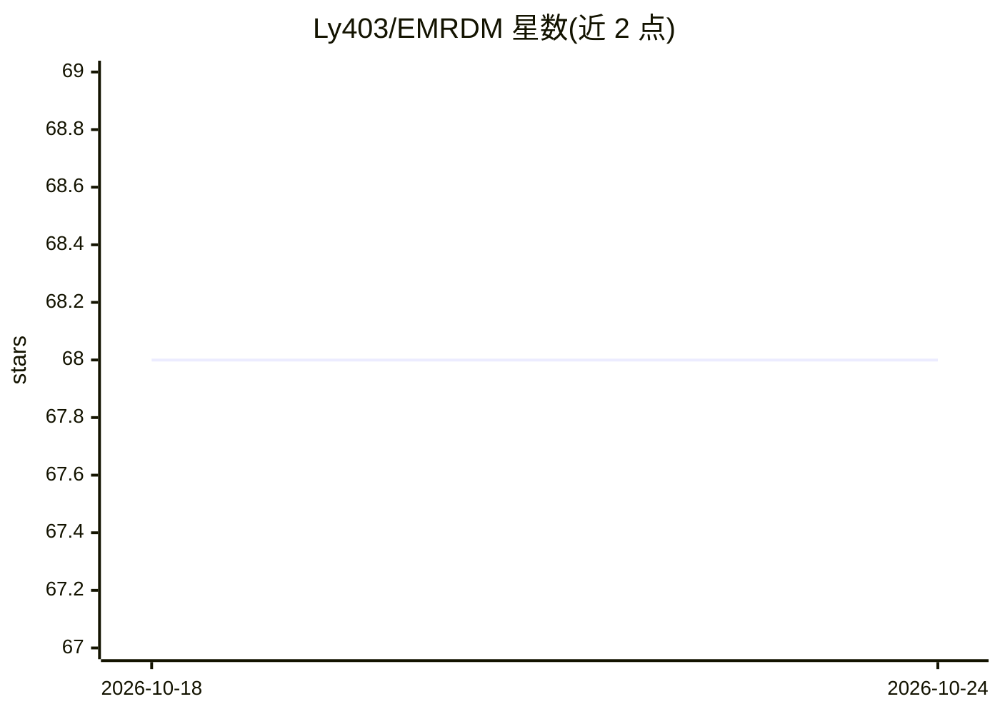

# Ly403/EMRDM

⭐ 68 · Python · AGPL-3.0 · 推送 2026-01-10 · [GitHub](https://github.com/Ly403/EMRDM) · [官网](https://arxiv.org/abs/2503.23717) · 组织维护 · 中文 README

**CVPR 2025 论文官方实现：遥感图像去云的扩散模型**

EMRDM 是 CVPR 2025 论文的官方 PyTorch 实现，用于遥感影像去云：在均值回扩散模型基础上改进，提供模块化框架与消融实验配置，支持单时相（CUHK-CR1/CR2、SEN12MS-CR）与多时相（Sen2_MTC_New）两类数据集的训练、测试与预测。训练权重、配置与日志通过 Google Drive、阿里云盘与百度网盘发布。环境依赖较复杂（torch、flash_attn、natten、pytorch-lightning 等需按指定版本安装），预测过程仅支持单 GPU。另提供中文 readme。

## 筛选速览

| 维度 | 判定 | 备注 |
|---|---|---|
| AI 角色 | `ai-native` | 本体是模型或模型工具 |
| 许可风险 | `viral` | AGPL-3.0 |
| 部署形态 | `library` | 以包/库形式分发 |
| 模型依赖 | — | README 未给出锁定关系 |
| 硬件要求 | — | 无带数字的原话,不猜 |
| 安装摩擦 | `medium` | 含编译或系统依赖之一 |
| 成熟度 | — | 结构信号不足 |

## 能力要点

- 基于改进均值回扩散模型的去云方法官方实现
- 支持 CUHK-CR1/CR2、SEN12MS-CR、Sen2_MTC_New 四个数据集
- 公开四个数据集上训练的模型权重与训练/测试日志
- 提供 yaml 配置驱动的训练/测试/预测命令与消融实验配置

## 适用场景

- 复现论文的去云训练与测试结果
- 用自己的遥感数据训练或微调去云模型
- 对已有遥感影像批量生成去云图像

## 场景标签

`图像生成` `图像视频处理` · 领域:内容生成

## 证据(README 行号)

> L13: This is the official repository for **EMRDM**, which is a novel cloud removal methods improved from mean-reverting 
> L71: ### :pushpin:Dataset
> L92: python main.py --base configs/example_training/[yaml_file_name].yaml --enable_tf32

## 星数曲线

2026-10-18 68 → 2026-10-24 68（+0）

---
*卡片 v1 · prompt 1.4 · 生成 2026-10-24 · 置信度 high · 依据 README sha `1c138c13a710` · [字段定义](../../DATASET.md)*
