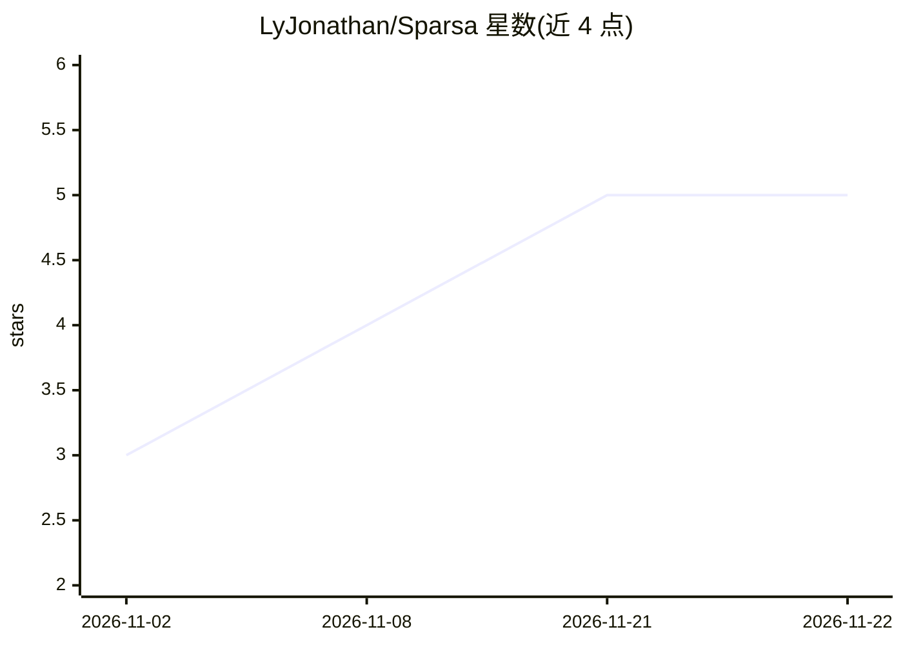

# LyJonathan/Sparsa

⭐ 5 · C++ · MIT · 推送 2026-11-06 · [GitHub](https://github.com/LyJonathan/Sparsa) · 个人维护

**让普通 PC 双显卡本地运行 MiniMax-M3.1-Flash 的推理引擎**

面向消费级硬件的本地 LLM 推理引擎：将 427B 参数 MoE 模型的热点专家置于 GPU，其余存放于锁定内存与 SSD 并按需搬运，用张量核心、双 PCIe 链路和异步拷贝提升吞吐；README 给出实测指标（4,000-token prompt 245 tok/s，32K 上下文解码约 8 tok/s）。模型权重以自建 GGUF 分层量化格式发布在 Hugging Face，多数层无法被现有通用本地运行时加载。提供 Windows/Linux 预编译引擎与源码构建路径，本地起服务后暴露 OpenAI 与 Anthropic 两种 API 格式。项目标注 EXPERIMENTAL，已测上下文上限 32K，仅测过 Linux 双卡配置。

## 筛选速览

| 维度 | 判定 | 备注 |
|---|---|---|
| AI 角色 | `ai-ecosystem` | LLM/agent 周边工具 |
| 许可风险 | `permissive` | MIT |
| 部署形态 | `library` | 以包/库形式分发 |
| 模型依赖 | — | README 未给出锁定关系 |
| 硬件要求 | `gpu-8g` | |
| 安装摩擦 | `high` | 编译与系统依赖俱全 |
| 成熟度 | `idea` | |

## 能力要点

- MoE 专家分层存储（GPU/锁定内存/SSD）与按需搬运机制
- 预下载 GGUF 分层量化（IQ1_S 至 NVFP4，94.8–246.1 GB）发布于 Hugging Face
- 本地服务同时提供 OpenAI /v1/chat/completions 与 Anthropic /v1/messages 接口，支持流式与工具调用
- 提供 Windows/Linux 预编译 CUDA 引擎与源码构建两条路径

## 适用场景

- 在两张 16 GB 消费级显卡的 PC 上本地运行 427B MoE 模型
- 为本地模型提供 OpenAI/Anthropic 兼容 API 供应用接入
- 按机器内存显存容量选择合适的量化分层并自动规划

## 场景标签

`推理引擎` `模型量化` · 领域:训练与推理

## 证据(README 行号)

> L90: `serve` loads the model (a minute or two). It then serves a chat page and two APIs on `http://127.0.0.1:8080`:
> L26: MiniMax-M3.1-Flash has 60 layers and 128 experts in each MoE layer, with 4 active per token. Sparsa keeps the hot
> L91: OpenAI's `/v1/chat/completions` and Anthropic's `/v1/messages`, model `minimax-m3.1-flash`, with streaming and tool

## 星数曲线

2026-11-02 3 → 2026-11-22 5（+2）

---
*卡片 v1 · prompt 1.4 · 生成 2026-11-21 · 置信度 mid · 依据 README sha `47b4f5261754` · [字段定义](../../DATASET.md)*
