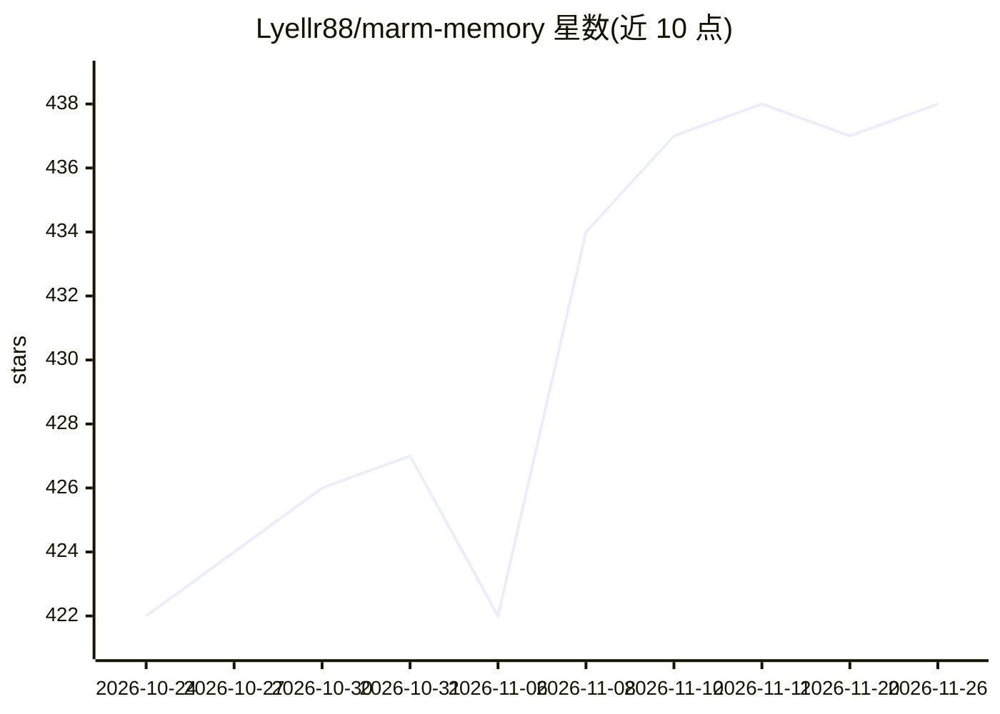

# Lyellr88/marm-memory

⭐ 438 · Python · Apache-2.0 · 推送 2026-11-12 · [GitHub](https://github.com/Lyellr88/marm-memory) · [官网](https://lyellr88.github.io/marm-memory) · 个人维护

**本地优先的 AI Agent 记忆层与 MCP 服务器，跨会话保存上下文**

以 SQLite 为存储的本地记忆服务器，通过 MCP 协议为多种编码 Agent 提供跨会话共享记忆。包含三组共 16 个工具：核心记忆（会话/笔记/摘要）、代码图（仓库索引与符号追踪）与概念图（实体关系抽取）。支持 HTTP 与 STDIO 两种传输，提供 swarm/swarm-max/trusted 多 Agent 共享配置，附带无需 Node.js 的本地 Web 控制台。检索采用 FTS 预过滤加语义/BM25/时间混合重排。维护者声明目前处于短暂暂停开发状态。

## 筛选速览

| 维度 | 判定 | 备注 |
|---|---|---|
| AI 角色 | `ai-ecosystem` | LLM/agent 周边工具 |
| 许可风险 | `permissive` | Apache-2.0 |
| 部署形态 | `self-host` | docker 或自建部署 |
| 模型依赖 | — | README 未给出锁定关系 |
| 硬件要求 | — | 无带数字的原话,不猜 |
| 安装摩擦 | `low` | 无编译、无系统依赖或容器化 |
| 成熟度 | — | 结构信号不足 |

## 能力要点

- 16 个 MCP 工具：核心记忆、代码图与概念图，HTTP/STDIO 双传输
- 检索用 FTS 关键词预过滤加语义+BM25+时间混合重排
- 多 Agent 共享记忆配置（swarm/swarm-max/trusted profile）
- 内置本地 Web 控制台，无需 Node.js

## 适用场景

- 让 Claude Code、Codex 等 Agent 跨会话保留项目决策与历史
- 多个 Agent 共享同一份本地记忆协同工作
- 为 Agent 提供仓库索引后的代码结构查询

## 场景标签

`Agent 记忆` `知识图谱` · 领域:Agent 开发

## 证据(README 行号)

> L20: marm-memory MCP server
> L73: marm-memory gives your agents a private, shared memory for the context that normally gets lost between chats: decis
> L81: All 16 tools work over HTTP and STDIO. Your agents share the same local memory across sessions instead of starting 

## 星数曲线

2026-10-24 422 → 2026-11-26 438（+16）

---
*卡片 v1 · prompt 1.4 · 生成 2026-11-25 · 置信度 mid · 依据 README sha `b0b060ca8537` · [字段定义](../../DATASET.md)*
