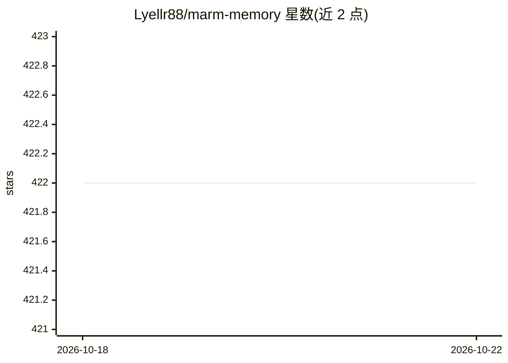

# Lyellr88/marm-memory

⭐ 422 · Python · Apache-2.0 · 推送 2026-10-21 · [GitHub](https://github.com/Lyellr88/marm-memory) · [官网](https://lyellr88.github.io/marm-memory) · 个人维护

**本地优先的 AI agent 记忆层与 MCP 服务器：跨会话持久记忆**

面向 AI 编程 agent 的本地记忆服务器，以 MCP 协议（HTTP/STDIO）接入 Claude Code、Codex、Cursor、VS Code 等 14 类客户端。三层能力：Core Memory 存储/检索会话与笔记，Code Graph 通过仓库索引提供符号查找与影响分析，Concept Graph 从记忆中抽取实体关系并回链代码。数据存于本地 SQLite（WAL 模式），检索采用 FTS 预过滤+语义/BM25/时间混合重排，默认整合关闭。附 Web Console 与 CLI，支持 Docker 与多 agent swarm 配置。

## 筛选速览

| 维度 | 判定 | 备注 |
|---|---|---|
| AI 角色 | `ai-ecosystem` | LLM/agent 周边工具 |
| 许可风险 | `permissive` | Apache-2.0 |
| 部署形态 | `self-host` | docker 或自建部署 |
| 模型依赖 | locked-api |  |
| 硬件要求 | — | 无带数字的原话,不猜 |
| 安装摩擦 | `low` | 无编译、无系统依赖或容器化 |
| 成熟度 | — | 结构信号不足 |

## 能力要点

- 8+6+2 共 16 个 MCP 工具，HTTP/STDIO 双传输
- SQLite 本地存储，FTS 预过滤+混合重排召回，基准数据公开
- 仓库索引生成 Code Graph，支持符号查找、调用追踪与影响分析
- 内置 Web Console（无需 Node.js）与 swarm/swarm-max/trusted 运行配置

## 适用场景

- 让编程 agent 跨会话、跨客户端保留项目决策与研究上下文
- 多个 agent 共享同一份本地记忆协同工作
- 通过概念图谱回溯某决策相关的人物、错误与代码位置

## 场景标签

`Agent 记忆` `多智能体` `知识图谱` · 领域:Agent 开发

## 证据(README 行号)

> L20: marm-memory MCP server
> L58: |**Solo developer / researcher**|`marm-memory start`|`"agent" mcp add --transport http marm-memory http://localhost

## 星数曲线

2026-10-18 422 → 2026-10-22 422（+0）

---
*卡片 v1 · prompt 1.4 · 生成 2026-10-21 · 置信度 mid · 依据 README sha `a73ef56e76b7` · [字段定义](../../DATASET.md)*
