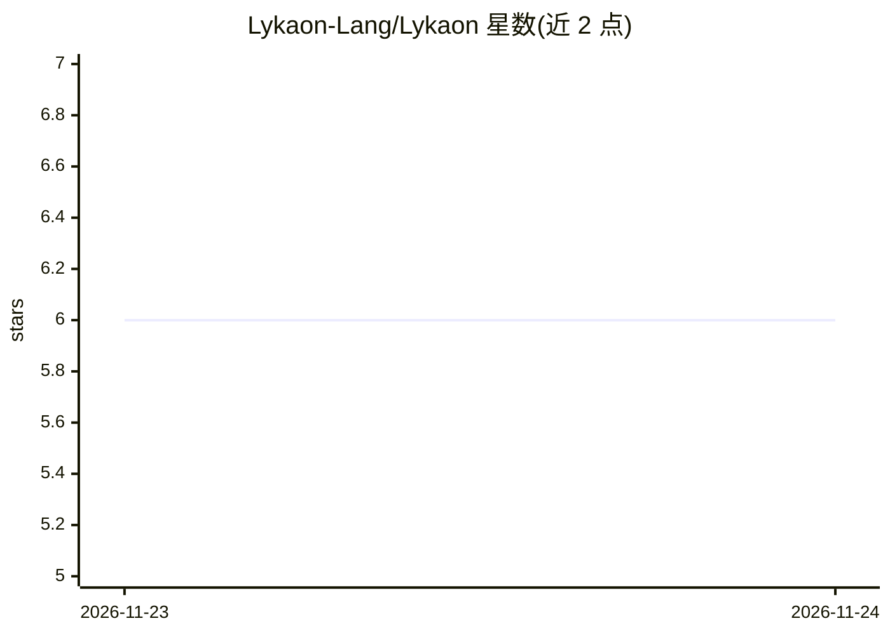

# Lykaon-Lang/Lykaon

⭐ 6 · Rust · NOASSERTION · 推送 2026-11-23 · [GitHub](https://github.com/Lykaon-Lang/Lykaon) · [官网](https://lykaon-lang.github.io/Lykaon/) · 组织维护

**类英语语法的编程语言：编译为原生可执行文件**

一种以接近自然英语的句子为语法的编程语言：句子以句号结尾、块用缩进表示，没有引号、花括号与分号；基于 Cranelift 的编译器将源码编译为独立原生可执行文件，同时提供 CLI 解释器。语言内建 CSV 表格、SQLite/PostgreSQL、HTTP/JSON、任务/通道与经典 ML 模型。当前为 v0.1 命令行语言，仅支持 Windows x64 与 Linux x64，无 GUI，性能尚未作为优化重点。许可为 source-available：个人及年收入低于 100 万美元的组织免费使用。

## 筛选速览

| 维度 | 判定 | 备注 |
|---|---|---|
| AI 角色 | `ai-enhanced` | 去掉 AI 部分产品仍成立 |
| 许可风险 | `none` | NOASSERTION |
| 部署形态 | `desktop` | 安装包/桌面程序 |
| 模型依赖 | — | README 未给出锁定关系 |
| 硬件要求 | — | 无带数字的原话,不猜 |
| 安装摩擦 | `medium` | 含编译或系统依赖之一 |
| 成熟度 | `idea` | |

## 能力要点

- 基于 Cranelift 的原生编译，构建无解释器依赖的独立可执行文件
- 语言内建 CSV、SQLite/PostgreSQL、HTTP/JSON、任务与通道
- 诊断信息包含 Where、Why 与 Fix
- 提供浏览器内 WASM playground，无需安装即可试用

## 适用场景

- 以类英语语法入门学习编程
- 编写数据处理与经典机器学习脚本
- 为初学者搭建可读性优先的教学代码

## 场景标签

`教程课程` · 领域:学习与行业

## 证据(README 行号)

> L67: - **Data, servers and AI in the language** — CSV tables, SQLite/PostgreSQL,
> L68:  HTTP/JSON, tasks/channels, classical ML models.
> L125: - M5 is in progress: data tables, SVG charts, classical ML models,

## 星数曲线

2026-11-23 6 → 2026-11-24 6（+0）

---
*卡片 v1 · prompt 1.4 · 生成 2026-11-23 · 置信度 mid · 依据 README sha `c81e76cc730a` · [字段定义](../../DATASET.md)*
