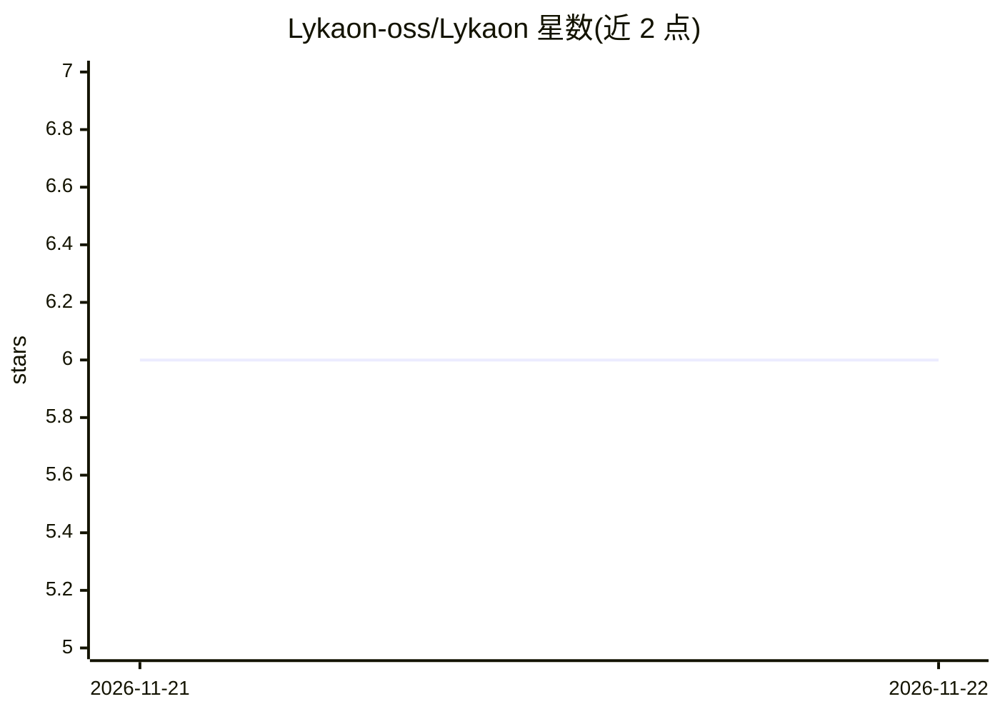

# Lykaon-oss/Lykaon

⭐ 6 · Rust · NOASSERTION · 推送 2026-11-21 · [GitHub](https://github.com/Lykaon-oss/Lykaon) · [官网](https://lykaon-oss.github.io/Lykaon/) · 个人维护

**面向初学者的类自然英文编程语言，可编译为原生可执行文件**

Lykaon 是一种以平实英文句子的形式书写代码的编程语言：句子以句号结尾、块用缩进表示、无引号/花括号/分号，编译器（基于 Cranelift）将代码编译为独立原生可执行文件，也可经解释器直接运行。语言内置 CSV 表格、SQLite/PostgreSQL、HTTP/JSON、任务/通道与经典 ML 模型支持。v0.1 为 Windows x64 与 Linux x64 的命令行语言，无 GUI，macOS 与 WebAssembly 输出尚未完成。许可是 source-available，非开源，免费供个人及年收入低于 100 万美元的组织使用。

## 筛选速览

| 维度 | 判定 | 备注 |
|---|---|---|
| AI 角色 | `ai-knowledge` | 知识聚合/清单类 |
| 许可风险 | `none` | NOASSERTION |
| 部署形态 | `desktop` | 安装包/桌面程序 |
| 模型依赖 | — | README 未给出锁定关系 |
| 硬件要求 | — | 无带数字的原话,不猜 |
| 安装摩擦 | `medium` | 含编译或系统依赖之一 |
| 成熟度 | `idea` | |

## 能力要点

- 类自然英文语法：句号结尾、缩进分块，无引号/花括号/分号
- 基于 Cranelift 的原生编译，单二进制独立运行无需解释器
- 语言内建 CSV、SQLite/PostgreSQL、HTTP/JSON、任务/通道与经典 ML 模型
- 诊断信息包含 Where/Why/Fix 三要素

## 适用场景

- 初学者以平实英文入门编程并直接生成可执行程序
- 用同一语言写数据表处理、服务器与并发任务
- 需要错误提示可读性高的教学场景

## 场景标签

 · 领域:开发者工具/编程语言

## 证据(README 行号)

> L3: **Lykaon is a programming language you read like plain English.**
> L65: - **A real compiler** — Cranelift-based native builds (`lykaonc-cli build`),
> L67: - **Data, servers and AI in the language** — CSV tables, SQLite/PostgreSQL,

## 星数曲线

2026-11-21 6 → 2026-11-22 6（+0）

---
*卡片 v1 · prompt 1.4 · 生成 2026-11-21 · 置信度 high · 依据 README sha `61c58ab7e85a` · [字段定义](../../DATASET.md)*
