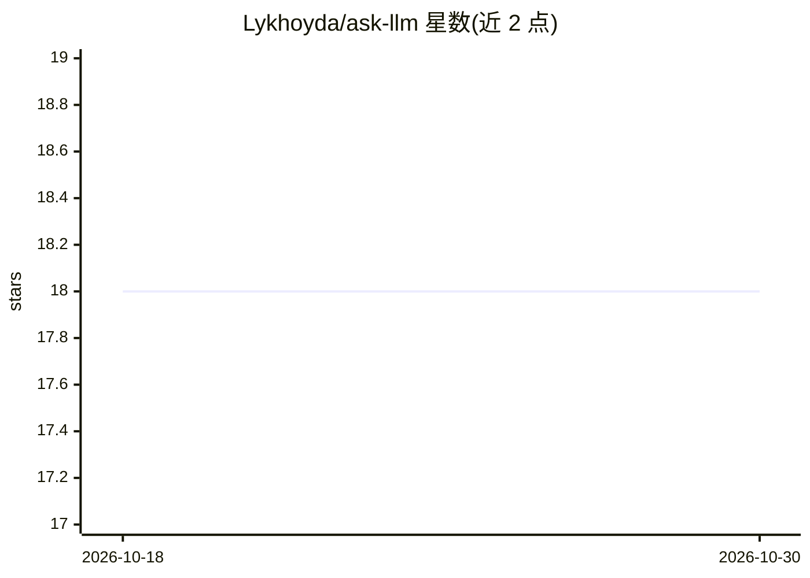

# Lykhoyda/ask-llm

⭐ 18 · TypeScript · MIT · 推送 2026-10-28 · [GitHub](https://github.com/Lykhoyda/ask-llm) · [官网](https://lykhoyda.github.io/ask-llm/) · 个人维护

**MCP 服务器：让编码助手内咨询其他厂商模型做代码评审**

面向已使用编码助手并订阅了其他模型的个人开发者与小团队：通过 MCP server 让 Claude Code 等宿主咨询 Codex、Grok、Ollama、Gemini 等其他厂商的模型，对代码变更做评审或对方案提出质疑，复用已有订阅、无需 API key。Setup 自动检测宿主并注册工具与工作流，评审以只读模式调用提供方，编辑权保留在宿主助手中。要求 Node.js 24+（Linux/macOS），提供方 CLI 须自行安装登录；本工具不负责安装提供方。

## 筛选速览

| 维度 | 判定 | 备注 |
|---|---|---|
| AI 角色 | `ai-ecosystem` | LLM/agent 周边工具 |
| 许可风险 | `permissive` | MIT |
| 部署形态 | `library` | 以包/库形式分发 |
| 模型依赖 | local-ok | 支持本地模型 |
| 硬件要求 | — | 无带数字的原话,不猜 |
| 安装摩擦 | `low` | 无编译、无系统依赖或容器化 |
| 成熟度 | — | 结构信号不足 |

## 能力要点

- 在编码助手会话内咨询其他厂商模型获取第二意见，无需 API key 或复制粘贴
- 支持 8 种宿主（Claude Code、Codex、Cursor、Gemini CLI、Grok Build 等）与 6 类提供方接入
- 评审默认只读，宿主助手保留编辑权，Opt-in 的 per-edit pairing 提供持续反馈
- 提供 ask-llm setup / doctor 命令做配置与排障

## 适用场景

- 让 Claude Code 咨询 Codex 对我的改动做安全评审
- 让另一个模型质疑我的技术方案假设
- 在本地用 Ollama 模型评审代码，不外发数据

## 场景标签

`代码审查` · 领域:编码与开发

## 证据(README 行号)

> L5: Get a second opinion on your code or plan, inside your coding assistant, using the model subscriptions you already h
> L42: A host is the assistant you work in; a provider is the model you consult.
> L73: Calls consume your existing provider plan's quota or follow that account's billing. Grok's xAI API is a separate, m

## 星数曲线

2026-10-18 18 → 2026-10-30 18（+0）

---
*卡片 v1 · prompt 1.4 · 生成 2026-10-29 · 置信度 high · 依据 README sha `7526bb906949` · [字段定义](../../DATASET.md)*
