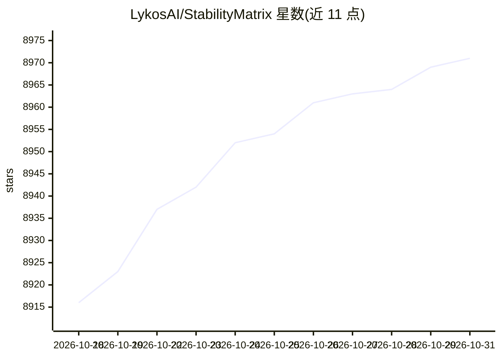

# LykosAI/StabilityMatrix

⭐ 8,971 · C# · AGPL-3.0 · 推送 2026-10-21 · [GitHub](https://github.com/LykosAI/StabilityMatrix) · [官网](https://lykos.ai) · 组织维护

**Stable Diffusion 多平台包管理器与内置推理界面**

面向 Stable Diffusion 用户的多平台桌面应用：一键安装与更新多个 Stable Diffusion Web UI 包（Automatic1111、ComfyUI、Fooocus、InvokeAI、SD.Next 等），管理各包的插件扩展与 Python 依赖，内嵌 Git 与 Python 无需全局安装，数据目录可整体迁移。内置 Inference 推理界面（语法高亮、工作区项目文件、A1111 兼容元数据），并共享模型目录、从 CivitAI 与 HuggingFace 导入模型。提供 Windows、Linux（AppImage/AUR）、macOS 安装包，支持十余种语言界面。

## 筛选速览

| 维度 | 判定 | 备注 |
|---|---|---|
| AI 角色 | `ai-ecosystem` | LLM/agent 周边工具 |
| 许可风险 | `viral` | AGPL-3.0 |
| 部署形态 | `None` |  |
| 模型依赖 | — | README 未给出锁定关系 |
| 硬件要求 | — | 无带数字的原话,不猜 |
| 安装摩擦 | `low` | 无编译、无系统依赖或容器化 |
| 成熟度 | — | 结构信号不足 |

## 能力要点

- 一键安装/更新 20+ 个 Stable Diffusion Web UI 包
- 内置 Inference 推理界面与 A1111 兼容元数据导出
- 内嵌 Git 与 Python，无需全局安装，数据目录完全可移植
- 从 CivitAI 与 HuggingFace 浏览导入模型并自动归类

## 适用场景

- 统一管理多个 Stable Diffusion Web UI 安装与更新
- 集中管理共享模型目录并在各包间复用
- 直接在应用内通过内置推理界面生成图片

## 场景标签

`图像生成` · 领域:内容生成

## 证据(README 行号)

> L10: Header image for Stability Matrix, Multi-Platform Package Manager and Inference UI for Stable Diffusion
> L17: Multi-Platform Package Manager and Inference UI for Stable Diffusion
> L21: ### 🖱️ One click install and update for Stable Diffusion Web UI Packages

## 星数曲线

2026-10-18 8,916 → 2026-10-31 8,971（+55）

---
*卡片 v1 · prompt 1.4 · 生成 2026-10-20 · 置信度 high · 依据 README sha `7932f14d2335` · [字段定义](../../DATASET.md)*
