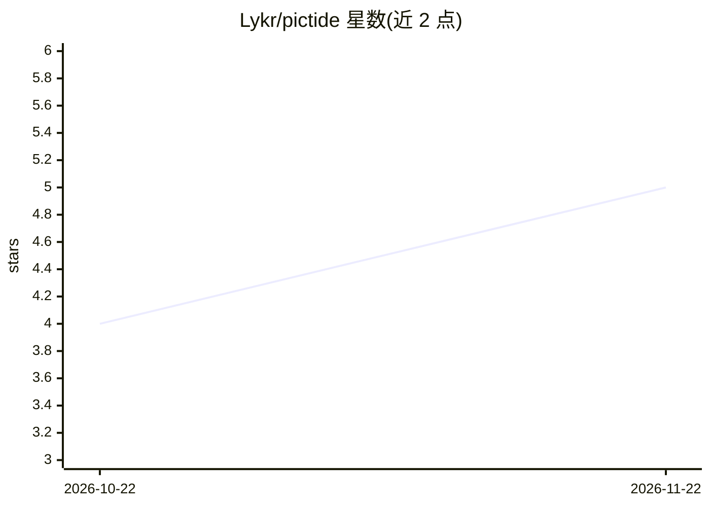

# Lykr/pictide

⭐ 5 · Python · Apache-2.0 · 推送 2026-11-13 · [GitHub](https://github.com/Lykr/pictide) · 个人维护

**本地运行的生成图像浏览器，按你的偏好学习推荐**

Pictide 是一个本地运行的生成式图像浏览器：用户无需编写提示词，通过浏览和标记喜欢的图片来训练偏好，影响后续的图像生成与推荐。核心功能板块包括漫游发现、按具体想法生成、收藏回顾与风格管理，图像与偏好数据保留在本地设备。服务器/NAS 场景可用 Docker Compose 部署；macOS 和 Linux 需自备 ComfyUI 或其他图像生成 API 后端。项目自述为概念验证（proof of concept）。

## 筛选速览

| 维度 | 判定 | 备注 |
|---|---|---|
| AI 角色 | `ai-native` | 本体是模型或模型工具 |
| 许可风险 | `permissive` | Apache-2.0 |
| 部署形态 | `self-host` | docker 或自建部署 |
| 模型依赖 | — | README 未给出锁定关系 |
| 硬件要求 | — | 无带数字的原话,不猜 |
| 安装摩擦 | `low` | 无编译、无系统依赖或容器化 |
| 成熟度 | `idea` | |

## 能力要点

- 无提示词的偏好学习交互：浏览并标记喜欢即可引导生成方向
- 图像与偏好数据保留在本地设备
- 支持 Docker Compose 部署到服务器/NAS，提供 amd64/arm64 预构建镜像
- 生成后端可连接 ComfyUI 或其他图像生成 API

## 适用场景

- 在本地探索生成图像并让推荐逐渐贴合个人口味
- 在 NAS 或服务器上自托管图像浏览与生成服务
- 免写提示词地尝试生成特定风格的图像

## 场景标签

`图像生成` · 领域:内容生成

## 证据(README 行号)

> L9: Pictide is a local generative image explorer that learns your preferences. No prompts to write or creative goal need
> L18: With an existing image service, first startup downloads about 110 MB for the default vocabulary and recommendation 

## 星数曲线

2026-10-22 4 → 2026-11-22 5（+1）

---
*卡片 v1 · prompt 1.4 · 生成 2026-11-22 · 置信度 high · 依据 README sha `ae4dde8baa9b` · [字段定义](../../DATASET.md)*
