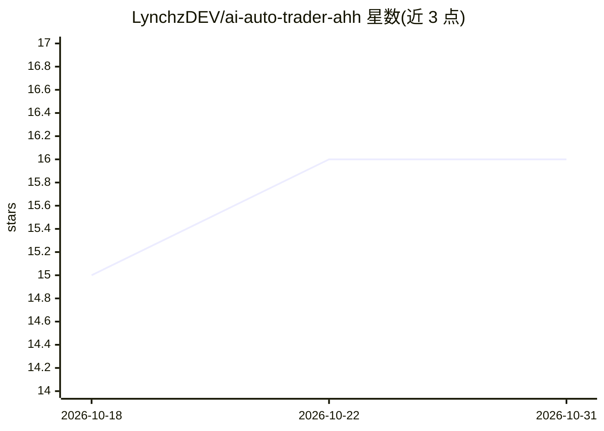

# LynchzDEV/ai-auto-trader-ahh

⭐ 16 · Go · MIT · 推送 2026-04-21 · [GitHub](https://github.com/LynchzDEV/ai-auto-trader-ahh) · [官网](https://demo-trade.lynchz.dev/) · 个人维护 · 中文 README

**多 AI 辩论共识驱动的币安合约自动交易平台**

Go 后端 + React 前端的加密货币合约自动交易系统：以固定周期（默认 5 分钟）循环计算技术指标，将账户与行情数据交给多个 AI 角色（多头/空头/分析师/反向/风控）辩论并经 OpenRouter 调用 LLM 产出 JSON 交易决策，再通过 15+ 层风控校验后在 Binance Futures 执行括号订单（支持 Testnet/Mainnet）。支持历史数据回测、实时仪表盘与 SSE 日志。需自备 OpenRouter API Key 与 Binance 账户，README 声明仅供教育实验用途。

## 筛选速览

| 维度 | 判定 | 备注 |
|---|---|---|
| AI 角色 | `ai-native` | 本体是模型或模型工具 |
| 许可风险 | `permissive` | MIT |
| 部署形态 | `self-host` | docker 或自建部署 |
| 模型依赖 | locked-api |  |
| 硬件要求 | — | 无带数字的原话,不猜 |
| 安装摩擦 | `low` | 无编译、无系统依赖或容器化 |
| 成熟度 | — | 结构信号不足 |

## 能力要点

- 多 AI 角色（Bull/Bear/Analyst/Contrarian/Risk Manager）辩论达成交易共识
- 15+ 层风控：入场过滤、多时间 frame 确认、持仓管理、每日止损限制
- 基于历史 Binance 数据的回测（Sharpe、最大回撤、胜率、盈亏比）
- WebSocket 实时仓位监控（官方称 1.13ms 平均延迟）与追踪止损

## 适用场景

- 接入 Binance Futures Testnet 自动执行合约策略
- 用历史数据回测多 AI 辩论交易策略
- 通过仪表盘实时监控仓位、权益曲线与 AI 决策记录

## 场景标签

`金融量化` `多智能体` · 领域:Agent 开发

## 证据(README 行号)

> L9: An advanced AI-powered cryptocurrency futures trading platform that leverages multi-agent debate consensus, comprehe
> L15: * **Advanced Decision Engine**: Integrates OpenRouter to access top-tier LLMs (DeepSeek, Claude, GPT-4) with Chain-
> L75: 3. **AI Decision**: Send structured prompt with account state, market data, and positions to LLM. The AI outputs a 

## 星数曲线

2026-10-18 15 → 2026-10-31 16（+1）

---
*卡片 v1 · prompt 1.4 · 生成 2026-10-30 · 置信度 high · 依据 README sha `22474ffddb5a` · [字段定义](../../DATASET.md)*
