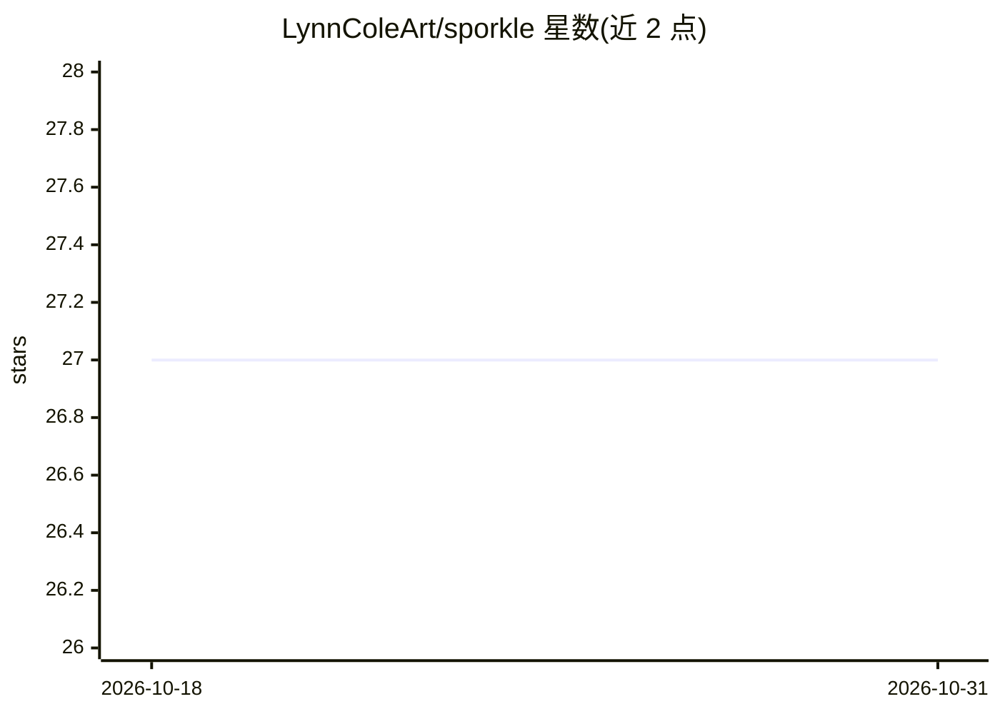

# LynnColeArt/sporkle

⭐ 27 · Fortran · MIT · 推送 2026-02-24 · [GitHub](https://github.com/LynnColeArt/sporkle) · 个人维护

**Fortran 异构计算编排框架：跨 AMD/NVIDIA 设备调度并行任务**

面向异构硬件（GPU/CPU）的 Fortran 编排层，通过统一设备抽象、内存管理与执行运行时调度并行任务，生产路径计划统一路由到 Kronos 后端（当前为 [planned]，迁移中）。README 采用声明标签体系（measured/implemented/experimental/planned），当前标注不稳定与活跃迁移状态，性能数字被有意省略待重建。安装需 Linux + Vulkan 能力 GPU、8GB 内存，通过 git clone 源码与 make 构建，Windows/macOS 路径为实验性或未验证。给需要设备无关并行执行的开发者/研究者使用。

## 筛选速览

| 维度 | 判定 | 备注 |
|---|---|---|
| AI 角色 | `ai-ecosystem` | LLM/agent 周边工具 |
| 许可风险 | `permissive` | MIT |
| 部署形态 | `None` |  |
| 模型依赖 | — | README 未给出锁定关系 |
| 硬件要求 | — | 无带数字的原话,不猜 |
| 安装摩擦 | `medium` | 含编译或系统依赖之一 |
| 成熟度 | `idea` | |

## 能力要点

- 统一设备抽象层覆盖设备枚举、能力查询与资源管理
- 内存/调度编排与平台检测已标记 [implemented]
- 声明标签体系区分 measured/implemented/experimental/planned
- Kronos 为唯一计划生产后端，PM4/OpenGL 路径仅留档参考

## 适用场景

- 在 AMD/NVIDIA GPU 上以统一编程模型调度并行内核
- 研究异构设备任务编排与自适应内核选择
- 以声明标签方式追踪框架声明的证据状态

## 场景标签

 · 领域:异构计算/并行计算框架

## 证据(README 行号)

> L20: Sporkle is a Fortran orchestration layer intended to execute through Kronos for production compute workloads.
> L43: The proliferation of heterogeneous computing architectures has created significant challenges in developing portabl
> L47: - **Orchestrated Compute via Kronos**: Primary production path for GPU/CPU task dispatch. **[planned]**

## 星数曲线

2026-10-18 27 → 2026-10-31 27（+0）

---
*卡片 v1 · prompt 1.4 · 生成 2026-10-26 · 置信度 mid · 依据 README sha `d3b9fb25bc57` · [字段定义](../../DATASET.md)*
