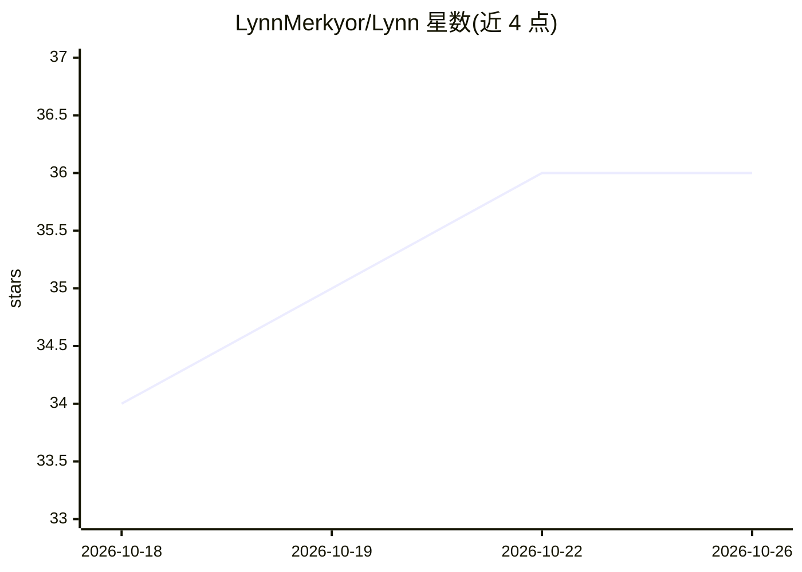

# LynnMerkyor/Lynn

⭐ 36 · TypeScript · Apache-2.0 · 推送 2026-10-24 · [GitHub](https://github.com/LynnMerkyor/Lynn) · [官网](https://github.com/MerkyorLynn/Lynn) · 个人维护 · 中文 README

**开源桌面 AI 助手与 CLI Agent：对话、语音、本地模型与无头 worker**

基于 Electron/TypeScript 的桌面 AI 助手，同时提供独立 CLI：支持聊天、搜索、文件处理、代码任务、实时语音（StepAudio 2.5 Realtime）与长期记忆。默认云端模型为 Step 5 Preview，由 Brain 路由托管；本地可安装 Qwen3.8-27B Coder390 EfficientThink 的 llama.cpp GGUF（Q2 需 16GB 显存/统一内存，Q3 需 24GB，含 SHA-256 校验）。CLI 可输出 JSON/JSONL 作为其他 Agent 或 CI 的无头 worker，可被 Codex / Claude Code / Qwen / Kimi 调用，安全边界在 Lynn 侧守门。

## 筛选速览

| 维度 | 判定 | 备注 |
|---|---|---|
| AI 角色 | `ai-native` | 本体是模型或模型工具 |
| 许可风险 | `permissive` | Apache-2.0 |
| 部署形态 | `desktop` | 安装包/桌面程序 |
| 模型依赖 | local-ok | 支持本地模型 |
| 硬件要求 | `gpu-8g` | |
| 安装摩擦 | `low` | 无编译、无系统依赖或容器化 |
| 成熟度 | — | 结构信号不足 |

## 能力要点

- GUI 与 CLI 共享默认模型与工具能力，CLI 可作为无头 worker 输出 JSONL
- 本地 Qwen3.8-27B Coder390 llama.cpp Q2/Q3 GGUF，按显存分档安装并做 SHA-256 校验
- --best 模式提供 300 步预算、任务分解、对抗式验收与 checkpoint/resume
- MCP OAuth、飞书桥、手机续聊 PWA 等扩展能力

## 适用场景

- 日常聊天、搜索、文件处理与代码任务的桌面助手
- 作为 Codex / Claude Code / Qwen 等 Agent 或 CI 的后台无头 worker
- 在 16GB/24GB 显存设备上本地运行 Coder390 模型做文本与代码任务

## 场景标签

`AI 助手` `语音 Agent` `编码 Agent` · 领域:编码与开发

## 证据(README 行号)

> L7:  开源桌面 AI 助手 · 聊天与任务进度一目了然 · 实时语音 · 长期记忆
> L22: Lynn 是同时提供桌面 GUI 与独立 CLI 的开源 AI Agent：用对话完成搜索、文件处理、代码任务和实时语音，也可以作为其他 Agent 或 CI 的无头 worker。**当前 GUI / CLI 均为 V0.87.
> L82: 桌面端管理对话、文件、任务进度与改动确认；CLI 提供终端交互、代码任务和无头 worker。两者共享默认模型与工具执行能力。CLI 可输出机器可读的 JSON / JSONL，供终端、CI 或其他 Agent 调用，无需把桌面窗

## 星数曲线

2026-10-18 34 → 2026-10-26 36（+2）

---
*卡片 v1 · prompt 1.4 · 生成 2026-10-25 · 置信度 high · 依据 README sha `82e1d6852c44` · [字段定义](../../DATASET.md)*
