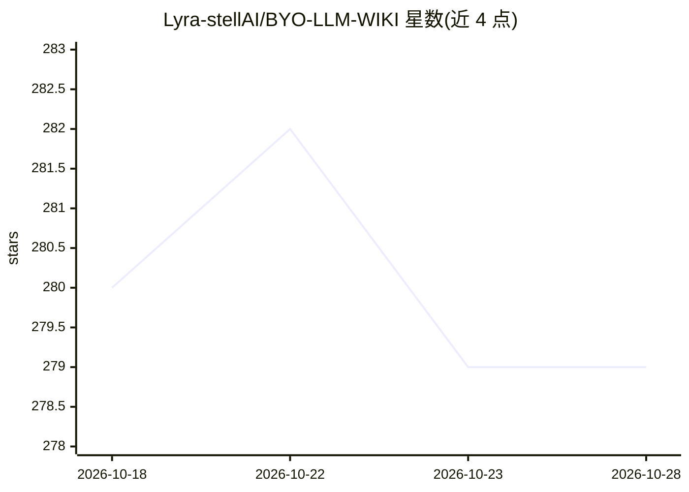

# Lyra-stellAI/BYO-LLM-WIKI

⭐ 279 · Python · 推送 2026-07-29 · [GitHub](https://github.com/Lyra-stellAI/BYO-LLM-WIKI) · 个人维护

**自建个人知识库应用：网页/文件转为带引用问答的本地 wiki**

Flask 应用，把网页、文件与笔记整理为本地个人 wiki：deepagents 代理驱动搜索、摘要、知识图谱构建（实体去重、主题嵌套、综合页生成），双层 HNSW 索引支撑带引用的 RAG 问答，跨会话记忆在每次回答前后读写。可从选定上下文自动生成技能，由 Claude 子代理或 Claude Code CLI 撰写，经确定性检查与评分面板后停在人工审核门槛，由人决定是否入库。本地优先，状态存于 data/ 下 JSON/SQLite，云为可选；支持 MCP 双向连接（写入默认拒绝）。提供 Web UI、HTTP API 与 runner.py CLI。RAG 需 OPENAI_API_KEY 做嵌入。

## 筛选速览

| 维度 | 判定 | 备注 |
|---|---|---|
| AI 角色 | `ai-native` | 本体是模型或模型工具 |
| 许可风险 | `none` | — |
| 部署形态 | `library` | 以包/库形式分发 |
| 模型依赖 | — | README 未给出锁定关系 |
| 硬件要求 | — | 无带数字的原话,不猜 |
| 安装摩擦 | `low` | 无编译、无系统依赖或容器化 |
| 成熟度 | — | 结构信号不足 |

## 能力要点

- 双层 HNSW 索引的 contextual RAG，回答带引用，可选 LLM 重排或 MMR
- deepagents 代理构建分层知识图谱（实体去重、主题嵌套、综合页）
- 技能生成经评估与评分面板后停在人工审核门槛，可作 LangGraph 持久构建暂停/恢复
- MCP 双向：接入外部 MCP 服务器并可自身作为 MCP 服务器运行

## 适用场景

- 把网页和散乱笔记整理成可问答的个人知识库
- 对自有资料做带引用的检索问答与跨文档综合
- 从选定上下文生成经人工审核的可复用 agent 技能

## 场景标签

`知识库管理` `文档问答` `RAG` `知识图谱` · 领域:知识与检索

## 证据(README 行号)

> L5: Turn the web, your files, and loose notes into a **personal wiki** that an LLM agent
> L20: - **Contextual RAG** — Anthropic-style *contextual retrieval* over a two-layer HNSW index
> L22:  (multi-doc recall). Answers are grounded and cited.

## 星数曲线

2026-10-18 280 → 2026-10-28 279（-1）

---
*卡片 v1 · prompt 1.4 · 生成 2026-10-22 · 置信度 high · 依据 README sha `0c977852f314` · [字段定义](../../DATASET.md)*
