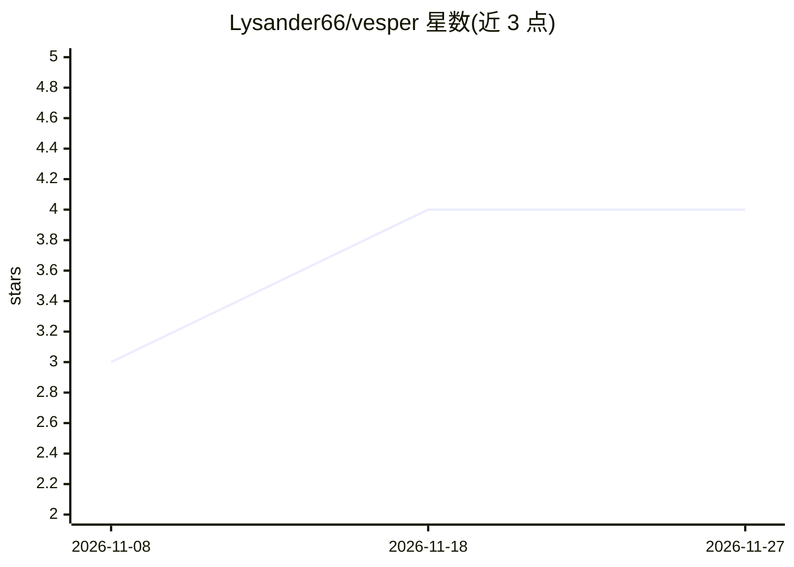

# Lysander66/vesper

⭐ 4 · TypeScript · Apache-2.0 · 推送 2026-11-06 · [GitHub](https://github.com/Lysander66/vesper) · 个人维护 · 中文 README

**把小说文本转成 AI 短剧/漫剧的本地工作流，可由 agent 驱动**

本地运行的小说转短剧工作流：分集、提取角色/场景/道具并生成参考图、改编为故事节拍、拆分镜头（含构图/运镜/时长/角色）、逐镜头生成首帧、视频片段与配音，最后拼接成集。各环节需人工确认后才继续，上游修改会将下游产物标记为过期；所有外部调用记录在本地并可导出为 cURL。提供 Web 界面，并附带 .agents/skills 目录的 agent 技能，供 Claude Code、Codex 等 agent 驱动整条流水线。

## 筛选速览

| 维度 | 判定 | 备注 |
|---|---|---|
| AI 角色 | `ai-native` | 本体是模型或模型工具 |
| 许可风险 | `permissive` | Apache-2.0 |
| 部署形态 | `None` |  |
| 模型依赖 | — | README 未给出锁定关系 |
| 硬件要求 | — | 无带数字的原话,不猜 |
| 安装摩擦 | `medium` | 含编译或系统依赖之一 |
| 成熟度 | — | 结构信号不足 |

## 能力要点

- 六段式流水线：分集→资产→节拍→镜头→生成→拼装
- Human in the loop：三个节点需人工确认，上游修改使下游产物标记 stale
- 调用记录本地保存并可导出为 cURL
- 内置 .agents/skills 供 Claude Code/Codex 等 agent 直接驱动

## 适用场景

- 把小说章节生成 38 镜头约 4 分钟的样片短剧
- 在本地控制角色/场景设定后批量生成视频片段
- 让 agent 接管整条流水线，人工只在关键节点确认

## 场景标签

`视频生成` `图像生成` · 领域:内容生成

## 证据(README 行号)

> L7:  A local workflow that turns novels into AI dramas.
> L32: 5. **Generation**: a first frame, a video clip, and voice for each shot.
> L67: The repo ships agent skills under `.agents/skills`, usable from Claude Code, Codex, pi, or any agent that reads tha

## 星数曲线

2026-11-08 3 → 2026-11-27 4（+1）

---
*卡片 v1 · prompt 1.4 · 生成 2026-11-21 · 置信度 high · 依据 README sha `e1d17d991e66` · [字段定义](../../DATASET.md)*
