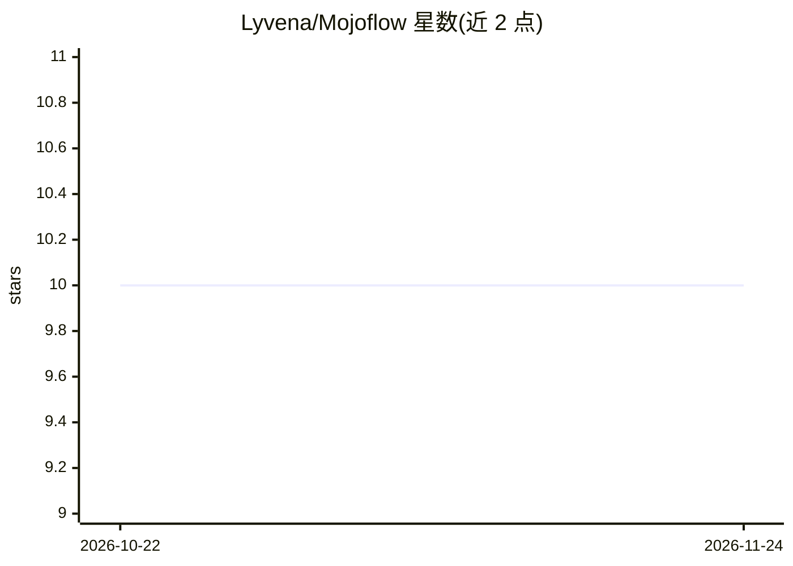

# Lyvena/Mojoflow

⭐ 10 · HTML · Apache-2.0 · 推送 2026-08-23 · [GitHub](https://github.com/Lyvena/Mojoflow) · [官网](https://www.lyvena.xyz/products/mojoflow/) · 组织维护

**audos 平台生成的 React 桌面型 Space 工作区与双向同步说明**

该仓库为 audos 平台自动生成的代码工作区（audos-workspace-823188/）：包含 Desktop.tsx 桌面外壳、config.json 应用清单、apps/ 下的配置驱动应用、landing-pages 与 mini-apps 单文件页面，以及 Otto agent 的 tools/ 目录。平台后端用 esbuild 编译（JSX 自动运行时、ESM 输出，React/Lucide 走 CDN importmap）。README 说明仓库与 audos 工作区之间的双向同步规则：audos 推送覆盖 README/AUDOS.md 与 *.generated.* 文件，GitHub 侧改动在下次同步时以仓库为准，提交带 [audos-sync] 标签以避免同步循环。

## 筛选速览

| 维度 | 判定 | 备注 |
|---|---|---|
| AI 角色 | `ai-enhanced` | 去掉 AI 部分产品仍成立 |
| 许可风险 | `permissive` | Apache-2.0 |
| 部署形态 | `None` |  |
| 模型依赖 | — | README 未给出锁定关系 |
| 硬件要求 | — | 无带数字的原话,不猜 |
| 安装摩擦 | `low` | 无编译、无系统依赖或容器化 |
| 成熟度 | — | 结构信号不足 |

## 能力要点

- 仓库与 audos 工作区双向同步，提交标签 [audos-sync] 并跳过自身提交避免循环
- 配置驱动的应用注册：应用须在 config.json 中有条目才会显示
- 后端 esbuild 编译，React/ReactDOM/Lucide 经 CDN importmap 解析
- Otto agent 工具位于 tools/ 目录

## 适用场景

- 在 audos 工作区里通过 GitHub 管理与版本控制 Space 代码
- 用 GitHub 侧删除文件/字段的方式移除 agent 添加的内容
- 通过开发者面板切换或断开同步模式（platform/external）

## 场景标签

 · 领域:开发工具/应用构建平台

## 证据(README 行号)

> L18: |`Desktop.tsx`|Your Space (the desktop)|The shell that draws your dock, app windows, app launcher, and Otto chat.|
> L26: |`tools/`|Otto's capabilities|Agent tools Otto can call.|

## 星数曲线

2026-10-22 10 → 2026-11-24 10（+0）

---
*卡片 v1 · prompt 1.4 · 生成 2026-11-20 · 置信度 low · 依据 README sha `6bb871e63874` · [字段定义](../../DATASET.md)*
