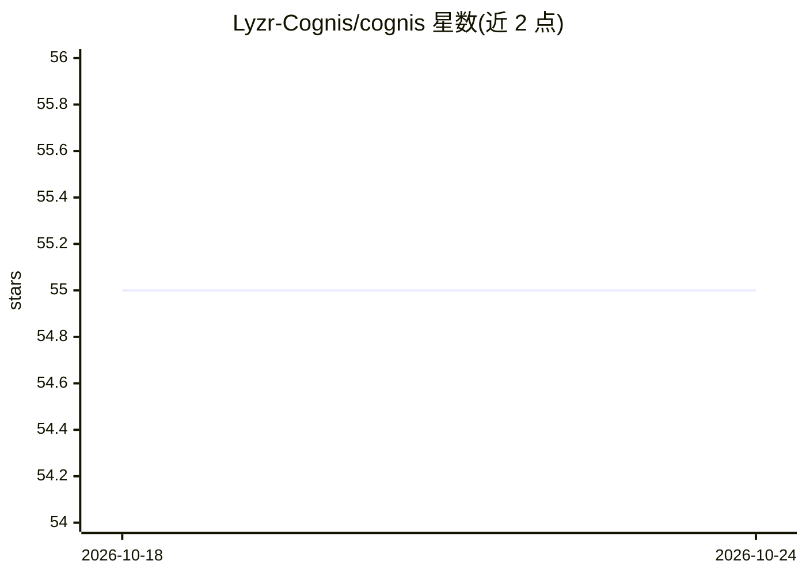

# Lyzr-Cognis/cognis

⭐ 55 · Python · MIT · 推送 2026-09-13 · [GitHub](https://github.com/Lyzr-Cognis/cognis) · [官网](https://www.lyzr.ai/cognis/) · 组织维护

**给 AI agent 开发者的轻量记忆库：本地优先或托管**

Python 库，为 AI agent 提供持久记忆：写入消息后由 LLM 抽取事实（13 类自动分类、ADD/UPDATE/DELETE 版本管理），检索用两级 Matryoshka 向量搜索加 BM25 关键词、RRF 融合。提供两种运行方式：本地 Cognis 类（Qdrant 本地模式 + SQLite，进程内运行，无需 Docker，但需自备 Gemini/OpenAI API key）与托管的 CognisClient（连接 Lyzr memory 服务，支持 API key/OIDC 认证、组织隔离与 RBAC），两者共享同一方法接口。

## 筛选速览

| 维度 | 判定 | 备注 |
|---|---|---|
| AI 角色 | `ai-ecosystem` | LLM/agent 周边工具 |
| 许可风险 | `permissive` | MIT |
| 部署形态 | `library` | 以包/库形式分发 |
| 模型依赖 | — | README 未给出锁定关系 |
| 硬件要求 | — | 无带数字的原话,不猜 |
| 安装摩擦 | `low` | 无编译、无系统依赖或容器化 |
| 成熟度 | — | 结构信号不足 |

## 能力要点

- 本地模式进程内运行（Qdrant 本地模式 + SQLite），无需 Docker 或服务器
- 混合检索：两级 Matryoshka 向量搜索 + BM25，RRF 融合
- LLM 驱动事实抽取，13 类自动分类与记忆版本管理
- 本地与托管共享同一 API，切换只需改一行

## 适用场景

- 为单机运行的 agent 添加跨会话长期记忆
- 团队/生产环境用托管服务并获得组织隔离与 RBAC
- 检索历史记忆并生成可直接拼入 LLM prompt 的上下文

## 场景标签

`Agent 记忆` · 领域:Agent 开发

## 证据(README 行号)

> L1: Cognis — Lightweight memory for AI agents
> L24: - **Smart extraction** — LLM-powered fact extraction with 13 auto-tagged categories, memory versioning (ADD/UPDATE/
> L22: - **Hybrid search** — Two-stage Matryoshka vector search (256D shortlist, 768D rerank) + BM25 keyword matching, fus

## 星数曲线

2026-10-18 55 → 2026-10-24 55（+0）

---
*卡片 v1 · prompt 1.4 · 生成 2026-10-24 · 置信度 high · 依据 README sha `ead2686a190c` · [字段定义](../../DATASET.md)*
