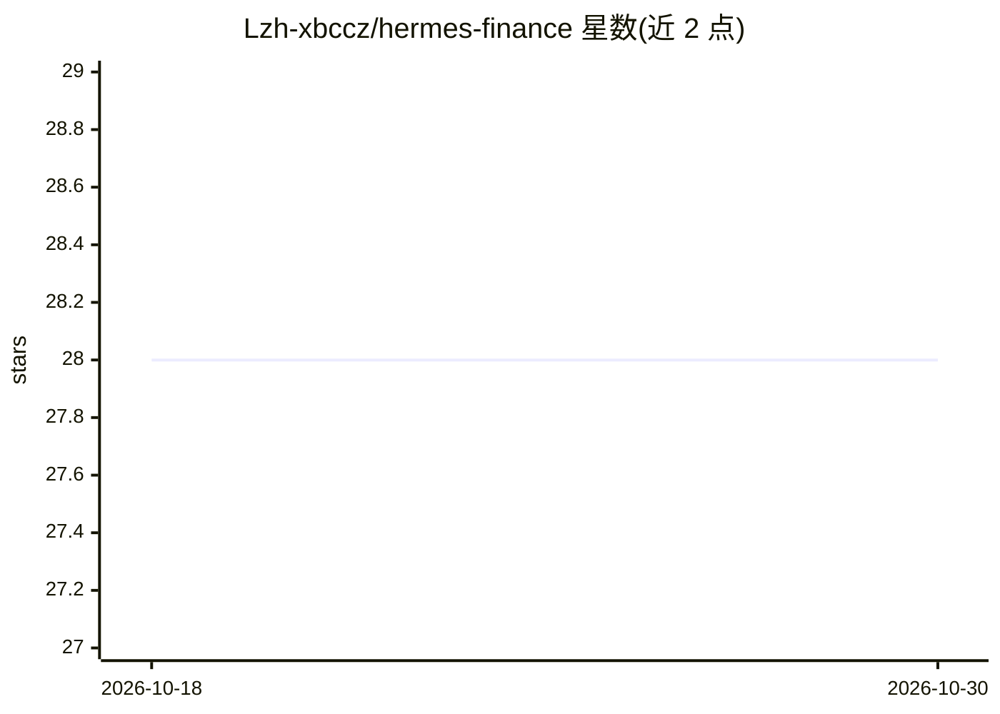

# Lzh-xbccz/hermes-finance

⭐ 28 · Python · MIT · 推送 2026-06-22 · [GitHub](https://github.com/Lzh-xbccz/hermes-finance) · 个人维护 · 中文 README

**面向 AI Agent 的多市场金融分析框架（MCP+Skills）**

为 Claude Code、Codex、Cursor 等 AI 工具提供的金融分析框架，通过 MCP server 与 Skills 双入口接入，也提供 CLI 与独立脚本。流程为六步：自动识别市场（加密货币/期货/外汇/A股/美股）、多源数据采集（缺失显式标注）、缠论引擎多级别结构分析、七维证据采集、AI 基于证据逻辑强度综合判断（非投票计数）、缠论作为第八维确认层。证据不足时输出观望；报告含数据完整性、反向审计、情景推演与交易计划。声明仅用于技术交流研究，不构成投资建议。

## 筛选速览

| 维度 | 判定 | 备注 |
|---|---|---|
| AI 角色 | `ai-ecosystem` | LLM/agent 周边工具 |
| 许可风险 | `permissive` | MIT |
| 部署形态 | `None` |  |
| 模型依赖 | — | README 未给出锁定关系 |
| 硬件要求 | — | 无带数字的原话,不猜 |
| 安装摩擦 | `low` | 无编译、无系统依赖或容器化 |
| 成熟度 | — | 结构信号不足 |

## 能力要点

- MCP + Skills 双入口，支持 Claude Code、Codex、Cursor、Gemini、Cline 等工具
- 加密/期货/外汇/A股/美股自动市场路由，多源数据采集并标注缺失
- 七维证据采集 + 缠论确认，方向由 AI 按证据逻辑强度判断而非投票计数
- 报告含数据完整性、反向审计、情景推演与交易计划

## 适用场景

- 在 Claude Code 等 AI 工具里直接说'分析 BTC'获取结构化分析报告
- 用 CLI 对多市场标的做七维证据采集与缠论结构分析
- 研究面向 AI Agent 的分层证据审计分析流程

## 场景标签

`金融量化` · 领域:学习与行业

## 证据(README 行号)

> L22: - MCP + Skills 双入口，AI 工具可以直接调用
> L43: 支持 Claude Code、Codex、Cursor、VS Code Copilot、Gemini、Roo、Cline 等。项目里配好了对应的 `.mcp.json` 等文件，AI 自动识别。

## 星数曲线

2026-10-18 28 → 2026-10-30 28（+0）

---
*卡片 v1 · prompt 1.4 · 生成 2026-10-26 · 置信度 high · 依据 README sha `7317d96d9b38` · [字段定义](../../DATASET.md)*
