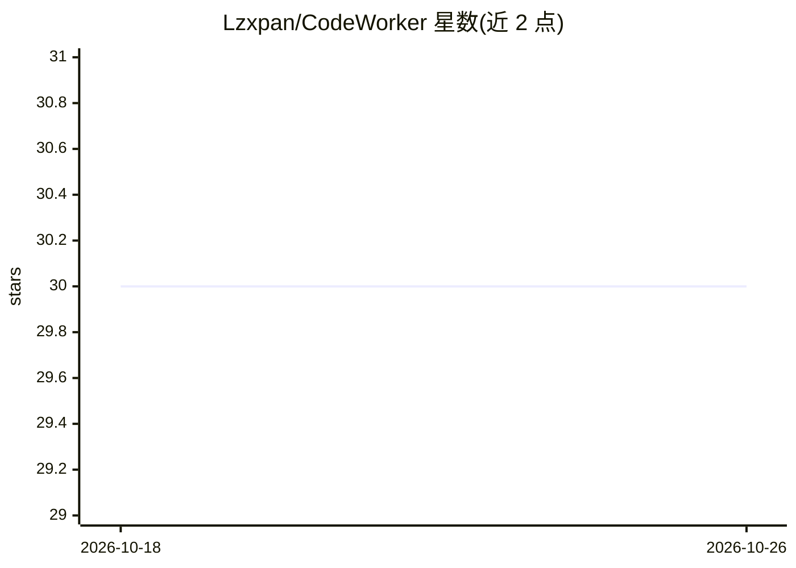

# Lzxpan/CodeWorker

⭐ 30 · Python · MIT · 推送 2026-05-24 · [GitHub](https://github.com/Lzxpan/CodeWorker) · 个人维护 · 中文 README

**離線隱私優先的 Windows 本地 LLM 程式碼助理**

以 llama.cpp、WinPython、PortableGit、GGUF 模型與 Web UI 整合在同一 Windows 工作目錄的離線程式碼助理，面向不能上傳原始碼、不能使用雲端模型或 air-gapped 環境的開發者。支援多模型選擇（Gemma 4 26B、Qwen 3.5 9B Vision 等）、全專案 RAG 檢索、CodeGraph 語意索引、附件（圖/音/影）分析，以及『產生修改計畫→確認套用』的檔案修改流程（含 Git checkpoint 與復原）。第一次執行需網路下載 runtime 與模型，之後可離線使用；建議 32GB RAM 等級。

## 筛选速览

| 维度 | 判定 | 备注 |
|---|---|---|
| AI 角色 | `ai-native` | 本体是模型或模型工具 |
| 许可风险 | `permissive` | MIT |
| 部署形态 | `desktop` | 安装包/桌面程序 |
| 模型依赖 | local-ok | 支持本地模型 |
| 硬件要求 | `cpu-ok` | |
| 安装摩擦 | `medium` | 含编译或系统依赖之一 |
| 成熟度 | — | 结构信号不足 |

## 能力要点

- bundled llama.cpp 啟動本機 GGUF 模型，不需 Ollama 與 API key
- 全專案 RAG + CodeGraph（code_nodes/code_edges）語意索引與影響範圍查詢
- 修改計畫產生可審查 patch_file，經 Git checkpoint、使用者確認後真正修改檔案
- 支援程式碼/圖片/音訊/影片附件分析（FFmpeg 抽 keyframes、whisper.cpp 轉錄）

## 适用场景

- 在不能上雲端或 air-gapped 環境做專案問答與程式碼修改
- 在大型專案中先查 symbol 關聯再釘選檔案分析
- 讓本地模型產生可審查 diff 並經確認後直接修改專案檔案

## 场景标签

`代码生成` `代码审查` `RAG` · 领域:编码与开发

## 证据(README 行号)

> L3: > 離線、可攜、以隱私與資安為優先的 Windows 本地 LLM 程式碼助理。
> L9: `CodeWorker` 將 `llama.cpp`、`WinPython`、`PortableGit`、GGUF 模型與 Web UI 整合在同一個 Windows 工作目錄。它適合不能上傳原始碼、不能使用雲端模型，或需要帶到客戶
> L13: - 本機模型服務：初始 fallback 為 `Gemma 4 26B`，之後會把最後一次成功使用的模型作為預設模型；所有模型都由 bundled `llama.cpp` service 啟動，不需要 Ollama。

## 星数曲线

2026-10-18 30 → 2026-10-26 30（+0）

---
*卡片 v1 · prompt 1.4 · 生成 2026-10-26 · 置信度 high · 依据 README sha `dfa498facf11` · [字段定义](../../DATASET.md)*
