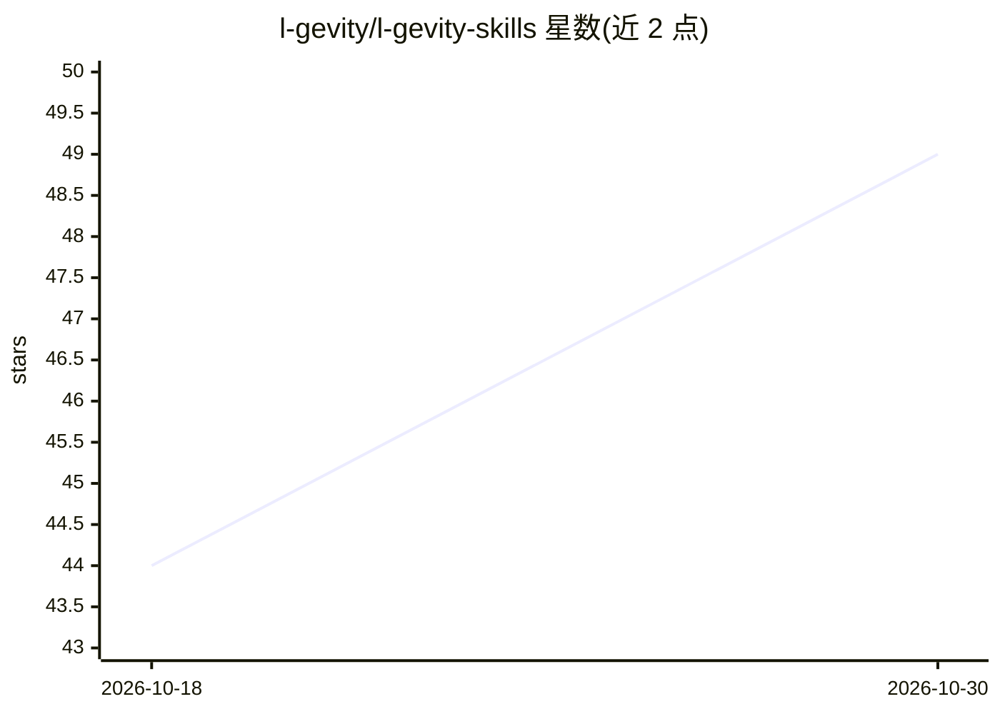

# l-gevity/l-gevity-skills

⭐ 49 · Python · MIT · 推送 2026-10-29 · [GitHub](https://github.com/l-gevity/l-gevity-skills) · [官网](https://l-gevity.nl) · 个人维护

**给编程 agent 的软件架构思维技能库（23 个技能）**

面向 Claude Code、Codex 等编程 agent 的技能库：以 `alchemy` 为路由入口，按任务强度自动选择 23 个可组合技能中的一个或最小有序子集，教 agent 从结构层面思考软件——功能是否值得其复杂度、子系统边界是否合理、重构是否真正简化系统、架构规则能否编码为检查等。安装方式为让 agent 执行 'Install l-gevity/l-gevity-skills' 提示词。每个技能含 SKILL.md 与独立概念导读。

## 筛选速览

| 维度 | 判定 | 备注 |
|---|---|---|
| AI 角色 | `ai-ecosystem` | LLM/agent 周边工具 |
| 许可风险 | `permissive` | MIT |
| 部署形态 | `None` |  |
| 模型依赖 | — | README 未给出锁定关系 |
| 硬件要求 | — | 无带数字的原话,不猜 |
| 安装摩擦 | `low` | 无编译、无系统依赖或容器化 |
| 成熟度 | — | 结构信号不足 |

## 能力要点

- `alchemy` 路由器按任务自动分派（SKIP/DIRECT/ADAPTIVE/FULL）最小技能集
- A.L.C.H.E.M.Y. 七道门：从最小价值到产出的架构评审流水线
- living topology 机制：子系统以 domain/tier/layer 三坐标机械判定依赖合法性（七种非法依赖形态）
- 23 个可组合技能，每个含 SKILL.md 与独立 primer

## 适用场景

- 让编程 agent 在重构前判断是否值得做、放在哪里
- 把架构边界编码为可执行的 architecture-as-code 规则
- 设计左移缺陷检测与可靠的 CI/CD 流水线
- 审计 PR 或整体架构的复杂度与简化空间

## 场景标签

`提示工程` · 领域:Agent 开发

## 证据(README 行号)

> L15: Most agent skills teach an AI *how* to do specific tasks — write tests,
> L17: They teach an agent how to *think* about software at a structural level:
> L37: > Install l-gevity/l-gevity-skills into this project.

## 星数曲线

2026-10-18 44 → 2026-10-30 49（+5）

---
*卡片 v1 · prompt 1.4 · 生成 2026-10-25 · 置信度 high · 依据 README sha `94c6f58fd10a` · [字段定义](../../DATASET.md)*
