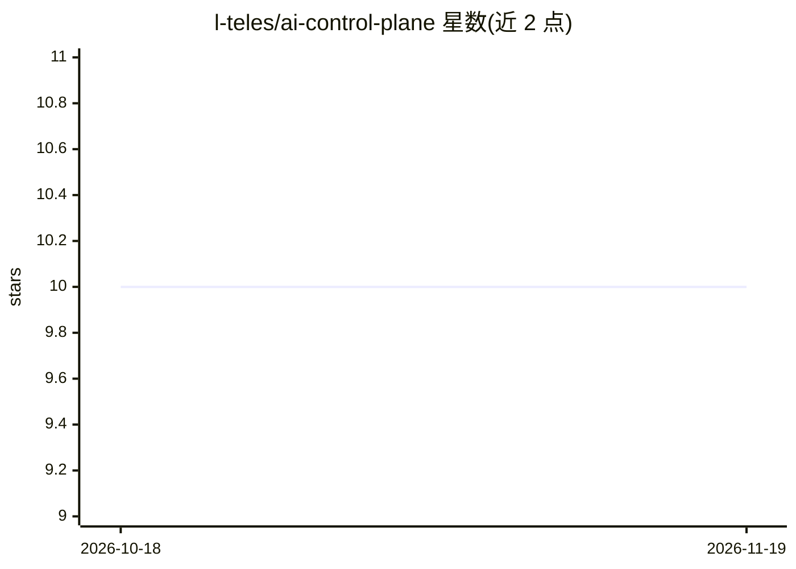

# l-teles/ai-control-plane

⭐ 10 · Python · MIT · 推送 2026-11-05 · [GitHub](https://github.com/l-teles/ai-control-plane) · [官网](https://pypi.org/project/ai-ctrl-plane/) · 个人维护

**本地 Web UI：统一浏览 AI 编码 agent 会话日志与工具配置**

读取 GitHub Copilot、Claude Code、VS Code Chat 三类工具在本机的会话日志与配置文件，解析为可交互仪表盘：会话时间线（DAG 排序、工具调用、子代理、错误）、SQLite FTS5 全文检索、日期范围过滤、token 用量统计，以及 MCP 服务器、插件、agents、skills、slash commands、hooks 等配置检查页。增量缓存按文件 mtime 刷新，带版本化 schema 迁移；默认仅绑定 127.0.0.1，含路径校验与 HTML 消毒等安全措施。提供 JSON API 供程序化访问。

## 筛选速览

| 维度 | 判定 | 备注 |
|---|---|---|
| AI 角色 | `ai-ecosystem` | LLM/agent 周边工具 |
| 许可风险 | `permissive` | MIT |
| 部署形态 | `library` | 以包/库形式分发 |
| 模型依赖 | — | README 未给出锁定关系 |
| 硬件要求 | — | 无带数字的原话,不猜 |
| 安装摩擦 | `low` | 无编译、无系统依赖或容器化 |
| 成熟度 | — | 结构信号不足 |

## 能力要点

- 多来源会话浏览：Copilot / Claude Code / VS Code Chat 并列展示，带来源徽标
- SQLite FTS5 全文检索对话内容，支持自然语言日期过滤
- 工具配置检查页覆盖 MCP 服务器、插件、agents、skills、hooks、feature flags
- JSON API 与 localhost-only 安全默认配置

## 适用场景

- 回顾 AI 编码代理的历史会话（提示词、工具调用、错误）
- 检查本机各 AI 工具安装的 MCP 服务器与 skills 配置
- 跨三个工具统一搜索对话内容与统计 token 用量

## 场景标签

 · 领域:开发者工具/AI 工具会话管理

## 证据(README 行号)

> L5:  A local web UI for browsing GitHub Copilot , Claude Code , and VS Code Chat agent session logs and tool configurati
> L10: AI coding agents produce rich session logs and configuration files. This tool turns
> L56: - **Multi-source support** — browse sessions from GitHub Copilot, Claude Code, and

## 星数曲线

2026-10-18 10 → 2026-11-19 10（+0）

---
*卡片 v1 · prompt 1.4 · 生成 2026-11-19 · 置信度 high · 依据 README sha `6c562b9d816c` · [字段定义](../../DATASET.md)*
