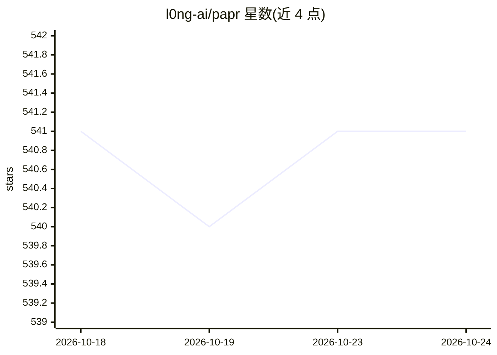

# l0ng-ai/papr

⭐ 541 · Rust · MIT · 推送 2026-09-23 · [GitHub](https://github.com/l0ng-ai/papr) · 个人维护 · 中文 README

**带 AI 摘要与 Agent CLI 的本地 RSS 阅读器**

Rust 编写的桌面 RSS 阅读器，提供订阅管理、智能视图、标签规则、全文抓取、FreshRSS/Miniflux 同步，数据全部保存在本地、无账户无云端。内置 AI 功能包括文章摘要、问答与摘要聚合（需自带 API key）。另一个形态是面向自主 agent 的 papr CLI，与桌面端共享同一本地数据库，支持读写、搜索、标记、订阅管理等操作；裸跑 papr 即输出未读面板与后续建议命令，输出采用 TOON 格式以减少 token，并提供按需加载的 papr-rss agent skill。macOS/Windows/Linux 均有安装包。

## 筛选速览

| 维度 | 判定 | 备注 |
|---|---|---|
| AI 角色 | `ai-enhanced` | 去掉 AI 部分产品仍成立 |
| 许可风险 | `permissive` | MIT |
| 部署形态 | `desktop` | 安装包/桌面程序 |
| 模型依赖 | — | README 未给出锁定关系 |
| 硬件要求 | — | 无带数字的原话,不猜 |
| 安装摩擦 | `medium` | 含编译或系统依赖之一 |
| 成熟度 | — | 结构信号不足 |

## 能力要点

- 桌面端与 CLI 共享同一本地数据库（papr-core crate）
- 面向 agent 的 CLI：读、搜索、标记、全文提取、OPML 管理
- 内置 AI 摘要、文章问答与摘要聚合（自带 API key）
- TOON 输出格式，称比 JSON 少约 40% token，带结构化退出码

## 适用场景

- 本地优先、无需账户地订阅和阅读 RSS
- 让 Claude Code 等 agent 通过 CLI 代我处理和分拣订阅
- 跨设备用 FreshRSS/Miniflux 同步阅读状态

## 场景标签

`AI 写作` `文档问答` · 领域:内容生成

## 证据(README 行号)

> L11: - **A desktop reader** — fast, native, offline-first. No account, no cloud.
> L25: - **AI** — summaries, ask-the-article Q&A, and digests. Bring your own API key.

## 星数曲线

2026-10-18 541 → 2026-10-24 541（+0）

---
*卡片 v1 · prompt 1.4 · 生成 2026-10-22 · 置信度 mid · 依据 README sha `fde6bb08668c` · [字段定义](../../DATASET.md)*
