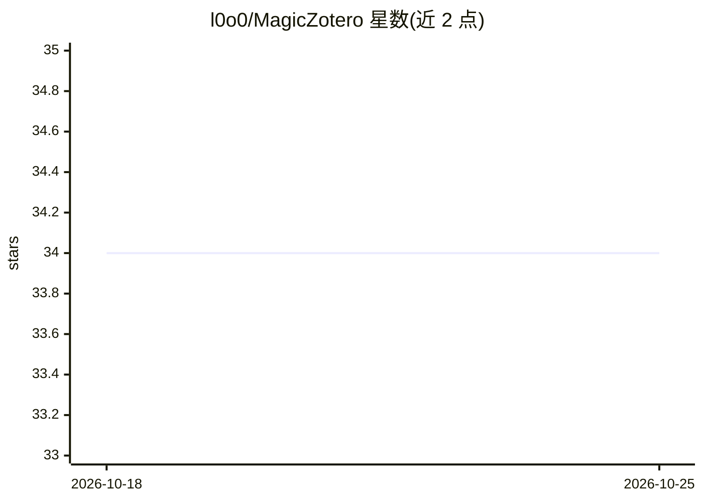

# l0o0/MagicZotero

⭐ 34 · 推送 2026-10-20 · [GitHub](https://github.com/l0o0/MagicZotero) · [官网](https://www.magiczotero.top/) · 组织维护 · 中文 README

**Zotero 插件：文献全文翻译与 AI 总结，付费订阅制**

面向 Zotero 7+ 用户的商业插件，在 Zotero 阅读窗口内提供文献全文翻译（MinerU、pdf2zh、Doc2X 等引擎，宣称支持 30+ 翻译引擎及 GPT 引擎翻译），并生成全文摘要、结构化大纲与多篇文献对比矩阵。以 .xpi 文件从 Zotero 插件管理安装，Windows/macOS/Linux 可用，使用 AI 功能需联网。采用 7 天全功能免费试用加付费订阅的授权模式，提供官方用户群技术支持。

## 筛选速览

| 维度 | 判定 | 备注 |
|---|---|---|
| AI 角色 | `ai-native` | 本体是模型或模型工具 |
| 许可风险 | `none` | — |
| 部署形态 | `None` |  |
| 模型依赖 | — | README 未给出锁定关系 |
| 硬件要求 | — | 无带数字的原话,不猜 |
| 安装摩擦 | `low` | 无编译、无系统依赖或容器化 |
| 成熟度 | — | 结构信号不足 |

## 能力要点

- Zotero 阅读窗口内全文翻译，支持 MinerU/pdf2zh/Doc2X 等引擎
- 一键全文摘要与结构化大纲生成
- AI 自动创建多篇文献对比分析矩阵
- 跨 Windows/macOS/Linux，需 Zotero 7+

## 适用场景

- 在 Zotero 中直接翻译外文文献全文
- 快速生成文献摘要与大纲辅助阅读
- 整理多篇文献为对比分析矩阵写综述

## 场景标签

`科研工具` · 领域:学习与行业

## 证据(README 行号)

> L5: **Magic for Zotero**™ (简称 MagicZotero) 是一款Zotero插件，通过先进的AI技术提供文献全文翻译和智能总结功能，彻底改变您的科研工作流程。
> L20: - **全文总结**：一键生成文献核心内容摘要

## 星数曲线

2026-10-18 34 → 2026-10-25 34（+0）

---
*卡片 v1 · prompt 1.4 · 生成 2026-10-25 · 置信度 high · 依据 README sha `52100b8ed701` · [字段定义](../../DATASET.md)*
