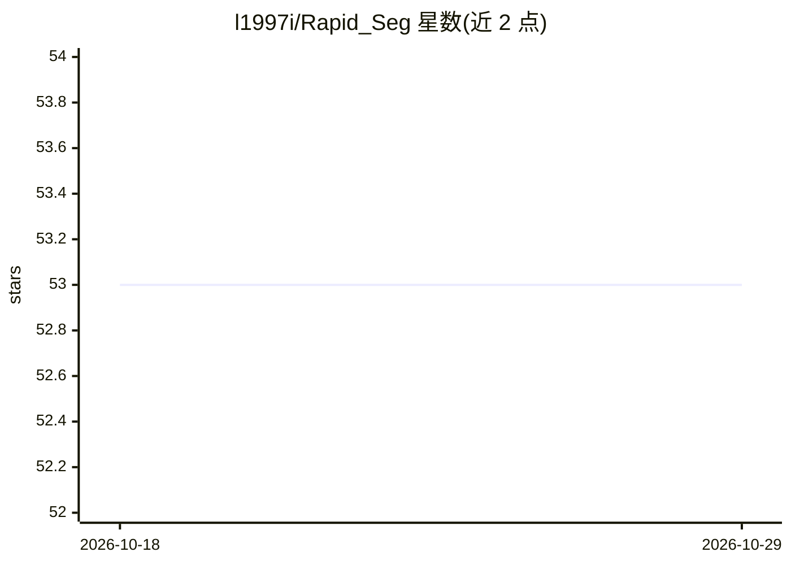

# l1997i/Rapid_Seg

⭐ 53 · Python · MIT · 推送 2026-07-01 · [GitHub](https://github.com/l1997i/Rapid_Seg) · 组织维护

**3D LiDAR 语义分割网络 RAPiD-Seg 的 PyTorch 实现（ECCV 2024 Oral）**

RAPiD-Seg 论文（ECCV 2024 Oral）的官方 PyTorch 实现：提供 RAPiD（Range-Aware Pointwise Distance Distribution）特征计算与分割网络，将局部几何与表面反射率组合为刚体变换不变、密度自适应的描述子，经双重嵌套自编码器嵌入，用于单模态 LiDAR 语义分割。支持 R- 与 C- 两种变体，默认 MinkowskiUNet34 骨干需 NVIDIA GPU 与 MinkowskiEngine（CUDA），无 CUDA 时自动回退轻量 voxel 骨干运行于 CPU。提供 SemanticKITTI 训练/评测脚本、pytest 测试套件与示例。

## 筛选速览

| 维度 | 判定 | 备注 |
|---|---|---|
| AI 角色 | `ai-native` | 本体是模型或模型工具 |
| 许可风险 | `permissive` | MIT |
| 部署形态 | `library` | 以包/库形式分发 |
| 模型依赖 | — | README 未给出锁定关系 |
| 硬件要求 | — | 无带数字的原话,不猜 |
| 安装摩擦 | `high` | 编译与系统依赖俱全 |
| 成熟度 | — | 结构信号不足 |

## 能力要点

- RAPiD 特征：几何+反射率的刚体变换不变描述子
- 近/中/远距离自适应邻居数（k_near/k_mid/k_far）的范围感知处理
- MinkowskiUNet34 GPU 骨干，无 CUDA 自动回退轻量 CPU 骨干
- SemanticKITTI 训练评测脚本与 pytest 测试套件

## 适用场景

- 在 SemanticKITTI 上训练和评测 3D LiDAR 语义分割模型
- 提取 RAPiD 特征用于点云/激光雷达分析
- 复现 ECCV 2024 论文实验结果

## 场景标签

`目标检测` · 领域:感知与多模态

## 证据(README 行号)

> L12: A PyTorch implementation of **RAPiD** features and the **RAPiD-Seg** network for
> L29: - **MinkowskiUNet34 Backbone**: full sparse-convolution backbone on NVIDIA GPUs; a lightweight voxel backbone is pr

## 星数曲线

2026-10-18 53 → 2026-10-29 53（+0）

---
*卡片 v1 · prompt 1.4 · 生成 2026-10-24 · 置信度 high · 依据 README sha `ee9ff23656ce` · [字段定义](../../DATASET.md)*
