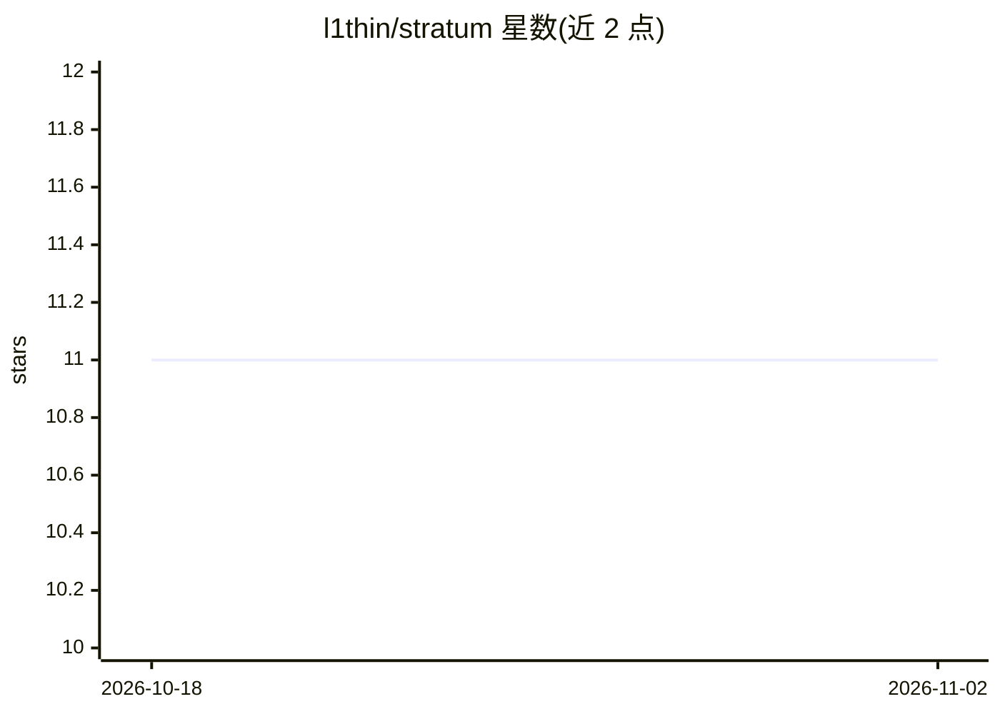

# l1thin/stratum

⭐ 11 · JavaScript · NOASSERTION · 推送 2026-06-17 · [GitHub](https://github.com/l1thin/stratum) · [官网](https://l1thin.github.io/stratum/) · 个人维护

**AI 图像分解工具：把平面图/生成图转成可编辑分层 PSD**

将 PNG/JPEG/WEBP 图像分解为分层 PSD 文件的 Web 应用：用 rembg（U-2-Net）做背景去除，OpenCV 轮廓检测定位并裁剪前景对象，PyTesseract 与 EasyOCR 双引擎提取文本图层，最终打包为标准 .psd；文本层通过 ExtendScript 脚本在 Photoshop 中重建为可编辑 TypeLayer。架构为 React 前端 + FastAPI 后端，提供统一 Docker 镜像，也支持 Hugging Face Spaces 部署。手写文字导入 Photoshop 需手动执行脚本。

## 筛选速览

| 维度 | 判定 | 备注 |
|---|---|---|
| AI 角色 | `ai-native` | 本体是模型或模型工具 |
| 许可风险 | `none` | NOASSERTION |
| 部署形态 | `self-host` | docker 或自建部署 |
| 模型依赖 | — | README 未给出锁定关系 |
| 硬件要求 | — | 无带数字的原话,不猜 |
| 安装摩擦 | `low` | 无编译、无系统依赖或容器化 |
| 成熟度 | — | 结构信号不足 |

## 能力要点

- rembg（U-2-Net）背景分离 + OpenCV GrabCut 后备
- PyTesseract 优先、EasyOCR（PyTorch）后备的多引擎 OCR
- 导出标准 .psd，ExtendScript 重建可编辑文本图层
- React + FastAPI 统一 Docker 镜像，支持 Hugging Face Spaces 部署

## 适用场景

- 把扁平设计图拆成背景/对象/文字图层以便在 Photoshop 中编辑
- 将 AI 生成图像转换为可分层修改的 PSD 文件
- 自托管图像分解服务供团队使用

## 场景标签

`图像视频处理` `OCR` · 领域:感知与多模态

## 证据(README 行号)

> L3: Stratum is an **AI-powered image decomposition framework** designed to decompose flat graphics into layered PSD file
> L23: - **AI Background Removal:** Powered by `rembg` (U-2-Net model) to isolate foreground graphics seamlessly.
> L26: - **Multi-Engine OCR:** Extract text layers via PyTesseract with a PyTorch-based EasyOCR fallback.

## 星数曲线

2026-10-18 11 → 2026-11-02 11（+0）

---
*卡片 v1 · prompt 1.4 · 生成 2026-11-02 · 置信度 high · 依据 README sha `988dca450eb6` · [字段定义](../../DATASET.md)*
