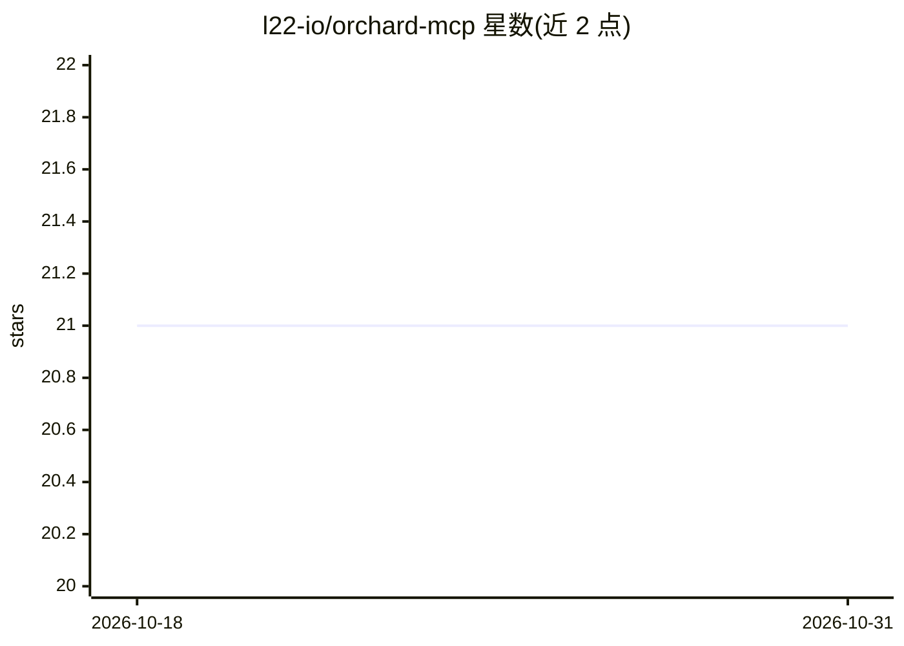

# l22-io/orchard-mcp

⭐ 21 · Swift · MIT · 推送 2026-06-19 · [GitHub](https://github.com/l22-io/orchard-mcp) · 组织维护

**macOS 原生应用的 MCP 服务器：让 AI 客户端读写日历/邮件/提醒等**

面向 MCP 兼容客户端（Warp、Claude Desktop、Claude Code、Cursor）的本地 macOS 服务器：通过 EventKit、Contacts.framework、AppleScript/JXA 等原生框架，提供 65 个工具，结构化读写 Apple 日历、邮件、提醒事项、备忘录、通讯录、文件及 Numbers/Pages/Keynote 文档。无云端依赖与 OAuth，认证由系统互联网账户处理；对 Mail/Notes 等调用设超时、队列与输出预算等安全护栏。要求 macOS 14+ 与 Node.js 22+，npm 全局安装后经 setup 向导配置。

## 筛选速览

| 维度 | 判定 | 备注 |
|---|---|---|
| AI 角色 | `ai-ecosystem` | LLM/agent 周边工具 |
| 许可风险 | `permissive` | MIT |
| 部署形态 | `library` | 以包/库形式分发 |
| 模型依赖 | — | README 未给出锁定关系 |
| 硬件要求 | — | 无带数字的原话,不猜 |
| 安装摩擦 | `low` | 无编译、无系统依赖或容器化 |
| 成熟度 | — | 结构信号不足 |

## 能力要点

- 65 个工具覆盖日历/邮件/提醒/文件/Notes/通讯录/iWork 十类对象
- TypeScript MCP 服务器 + Swift apple-bridge 原生二进制双层架构
- 无需 OAuth，认证走 macOS 系统设置与 TCC 授权
- App 安全护栏：超时、队列、输出预算与范围限制

## 适用场景

- 让 Claude/Cursor 等 AI 客户端直接管理我的日历、邮件和提醒事项
- 通过对话读写本机 Numbers/Pages/Keynote 文档
- 用 AI 检索本机文件并提取文本内容

## 场景标签

`AI 助手` · 领域:对话与助手

## 证据(README 行号)

> L5: MCP server for local macOS apps and files using native frameworks.
> L7: Gives any MCP-compatible client (Warp, Claude Desktop, Claude Code, Cursor) structured
> L219: 1. **TypeScript MCP server** (`src/`) - handles MCP protocol over stdio, Zod schemas, and tool routing

## 星数曲线

2026-10-18 21 → 2026-10-31 21（+0）

---
*卡片 v1 · prompt 1.4 · 生成 2026-10-28 · 置信度 high · 依据 README sha `ae423476a641` · [字段定义](../../DATASET.md)*
