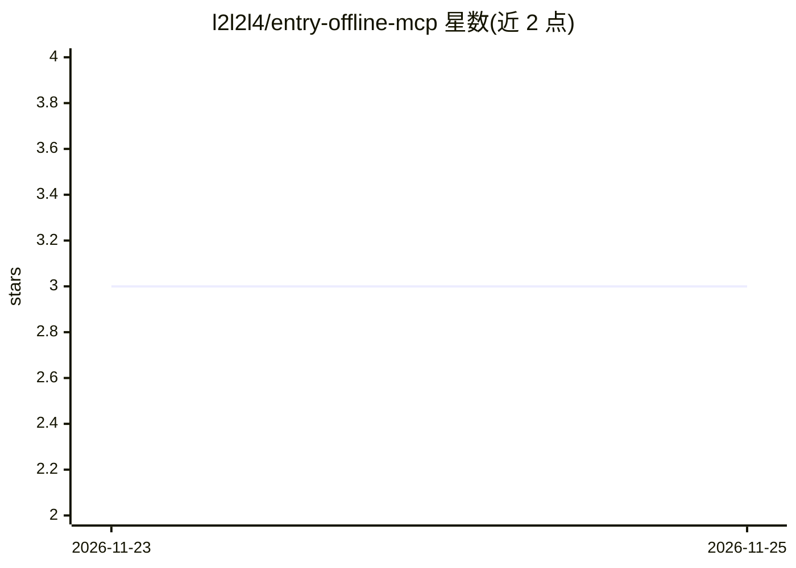

# l2l2l4/entry-offline-mcp

⭐ 3 · JavaScript · MIT · 推送 2026-11-22 · [GitHub](https://github.com/l2l2l4/entry-offline-mcp) · [官网](https://playentry.org/community/tips/6af7308dbac7cbb7eed4fd0f) · 个人维护

**让 Claude/Codex 等 AI 代理操控 Entry 离线版制作作品的 MCP 服务器**

以 MCP 服务器形式运行，通过 Chrome DevTools Protocol 连接本地安装的 Entry 离线应用（Electron），让 AI 代理执行对象添加（2000+ 素材检索）、图片上传、Python→积木转换、积木 JSON 编写、变量/函数/场景管理、运行测试与截图、.ent 存取等操作，实时在 Entry 窗口呈现。要求 Node.js 22+ 与 Entry 离线版，Windows 实测通过，macOS 仅经 CI 验证且 Apple Silicon 需 Rosetta。含生成式 AI 使用水印（隐藏变量与 ID 模式）。非官方项目，与 Entry（Connect 基金会）无关。

## 筛选速览

| 维度 | 判定 | 备注 |
|---|---|---|
| AI 角色 | `ai-ecosystem` | LLM/agent 周边工具 |
| 许可风险 | `permissive` | MIT |
| 部署形态 | `desktop` | 安装包/桌面程序 |
| 模型依赖 | — | README 未给出锁定关系 |
| 硬件要求 | — | 无带数字的原话,不猜 |
| 安装摩擦 | `low` | 无编译、无系统依赖或容器化 |
| 成熟度 | — | 结构信号不足 |

## 能力要点

- 提供 24 个 MCP 工具，覆盖项目创建、素材检索、脚本编写、运行验证全流程
- 通过隐藏变量与 ID 模式自动为 AI 生成的作品打水印标记
- 同时提供 Claude Code、Codex 及通用 MCP 客户端的接入配置
- 支持从 npm 包或 GitHub tarball 地址安装

## 适用场景

- 让 AI 代理帮我用积木编程做一个 Entry 小游戏
- 让 AI 写 Entry Python 代码并自动运行测试保存
- 教学场景中批量生成带 AI 标记的编程作品

## 场景标签

`编码 Agent` `GUI 自动化` · 领域:效率与自动化

## 证据(README 行号)

> L5: **Claude Code, Codex** 같은 AI 에이전트가 내 PC에 설치된 **엔트리 오프라인**(Entry, playentry.org)을 직접 조작해서
> L145: AI 에이전트(Claude Code · Codex 등) ⇄ (MCP, stdio) ⇄ entry-offline-mcp ⇄ (Chrome DevTools Protocol) ⇄ 엔트리 오프라인(Electron

## 星数曲线

2026-11-23 3 → 2026-11-25 3（+0）

---
*卡片 v1 · prompt 1.4 · 生成 2026-11-23 · 置信度 high · 依据 README sha `30ad342ee7c6` · [字段定义](../../DATASET.md)*
