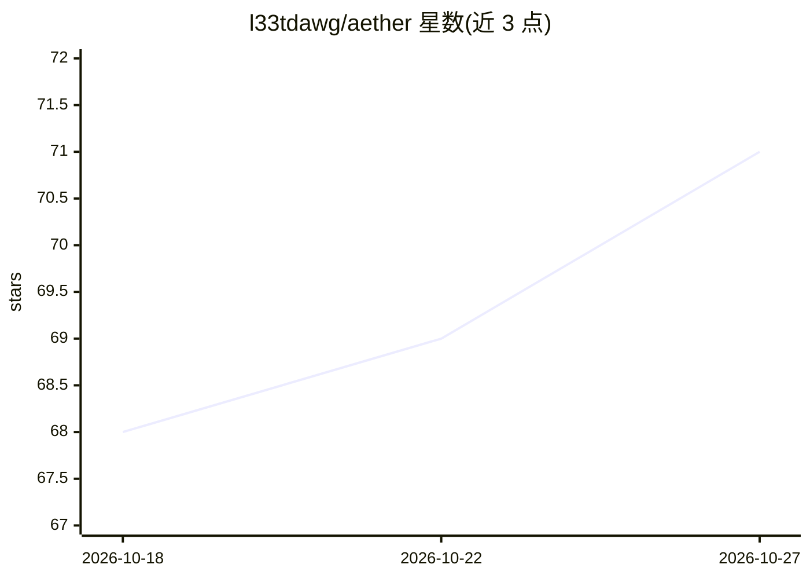

# l33tdawg/aether

⭐ 71 · Python · MIT · 推送 2026-04-27 · [GitHub](https://github.com/l33tdawg/aether) · 个人维护

**Solidity 智能合约安全审计框架：静态检测+LLM 多轮流水线生成漏洞报告与 PoC**

Python 编写的智能合约审计框架，面向安全研究员与赏金猎人。组合 Solidity AST 解析（py-solc-x）、污点分析、控制流图、跨合约分析、Halmos 符号执行、180+ 静态检测器与多 Agent LLM 流水线（GPT/Gemini/Claude 多供应商轮换），按 6 轮递进分析产出漏洞发现、Foundry PoC 测试并在主网分叉上验证利用。配套 SAGE 机构记忆系统（Docker 部署、170 条预置漏洞/原型知识）跨审计记录误报模式以减少重复发现，并有 ML 校准的检测器准确率反馈回路。以全屏持久化 TUI 形式运行。

## 筛选速览

| 维度 | 判定 | 备注 |
|---|---|---|
| AI 角色 | `ai-native` | 本体是模型或模型工具 |
| 许可风险 | `permissive` | MIT |
| 部署形态 | `self-host` | docker 或自建部署 |
| 模型依赖 | locked-api |  |
| 硬件要求 | — | 无带数字的原话,不猜 |
| 安装摩擦 | `low` | 无编译、无系统依赖或容器化 |
| 成熟度 | — | 结构信号不足 |

## 能力要点

- 6 轮递进 LLM 深度分析流水线（协议理解→攻击面→不变量→跨函数交互等）
- 180+ 静态检测器 + AST/污点分析/Halmos 符号执行
- 自动生成可编译执行的 Foundry PoC，支持主网分叉验证
- SAGE 机构记忆：跨审计复用误报模式，含 75 个漏洞模式与 20 个历史漏洞案例

## 适用场景

- 审计 DeFi 协议合约并生成可运行的漏洞复现测试
- 赏金挖掘时系统化检查不变量违背与跨合约风险
- 按 ERC-20 异常行为（fee-on-transfer 等 12 类）排查代币兼容风险

## 场景标签

`网络安全` · 领域:学习与行业

## 证据(README 行号)

> L5: Aether is a Python-based framework for analyzing Solidity smart contracts, generating vulnerability findings, produc
> L168: **Deep Analysis Engine** — Aether v3.5 fundamentally transforms how the tool finds vulnerabilities, moving from a 
> L174: |Pass|Purpose|Model Tier|

## 星数曲线

2026-10-18 68 → 2026-10-27 71（+3）

---
*卡片 v1 · prompt 1.4 · 生成 2026-10-24 · 置信度 mid · 依据 README sha `ac4899cd7838` · [字段定义](../../DATASET.md)*
