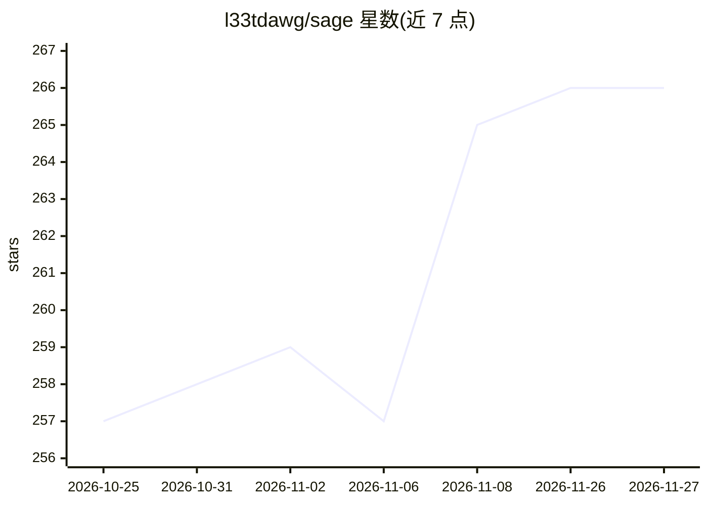

# l33tdawg/sage

⭐ 266 · Go · Apache-2.0 · 推送 2026-11-26 · [GitHub](https://github.com/l33tdawg/sage) · [官网](https://orcid.org/0009-0001-7248-2411) · 个人维护

**为 AI 代理提供可审计、可治理的记忆与消息层**

SAGE 是一个面向 AI 代理的受治理记忆与消息层：每条记忆由代理签名、经可审查的准入流程（个人模式单验证器，多验证器需 BFT 法定人数）、按权限域划分作用域，并保留可检视的审计轨迹。代理通过 MCP、Python SDK 或签名 REST API 接入，本地节点默认存储记忆，CEREBRUM 仪表盘提供注册、权限、召回调优与联邦管理。提供 macOS/Windows/Linux 桌面包、Docker 镜像与源码构建（Go）。

## 筛选速览

| 维度 | 判定 | 备注 |
|---|---|---|
| AI 角色 | `ai-ecosystem` | LLM/agent 周边工具 |
| 许可风险 | `permissive` | Apache-2.0 |
| 部署形态 | `self-host` | docker 或自建部署 |
| 模型依赖 | — | README 未给出锁定关系 |
| 硬件要求 | — | 无带数字的原话,不猜 |
| 安装摩擦 | `low` | 无编译、无系统依赖或容器化 |
| 成熟度 | — | 结构信号不足 |

## 能力要点

- 代理签名的记忆写入，附审计轨迹与置信度/衰减/弃用等生命周期控制
- 个人单验证器或多验证器 BFT 法定人数的共识准入
- CEREBRUM 本地仪表盘：3D 记忆脑图、链健康、联邦与权限管理
- 支持 MCP、Python SDK 与签名 REST API 三种接入方式

## 适用场景

- 让代理在跨会话时保留可追溯的设计决策与经验教训
- 团队需要对代理记忆做权限划分与准入审查
- 多代理协作场景下管理任务分配与运行时交接

## 场景标签

`Agent 记忆` `多智能体` · 领域:Agent 开发

## 证据(README 行号)

> L7: SAGE is a governed memory and messaging layer for AI agents. Every memory is
> L15: Works with Claude Code, Codex, Cursor and other MCP-capable clients. Developers
> L161: |MCP|Giving an existing AI client memory and coordination tools|Connection guide · MCP reference|

## 星数曲线

2026-10-25 257 → 2026-11-27 266（+9）

---
*卡片 v1 · prompt 1.4 · 生成 2026-11-25 · 置信度 mid · 依据 README sha `9d3867f805bc` · [字段定义](../../DATASET.md)*
