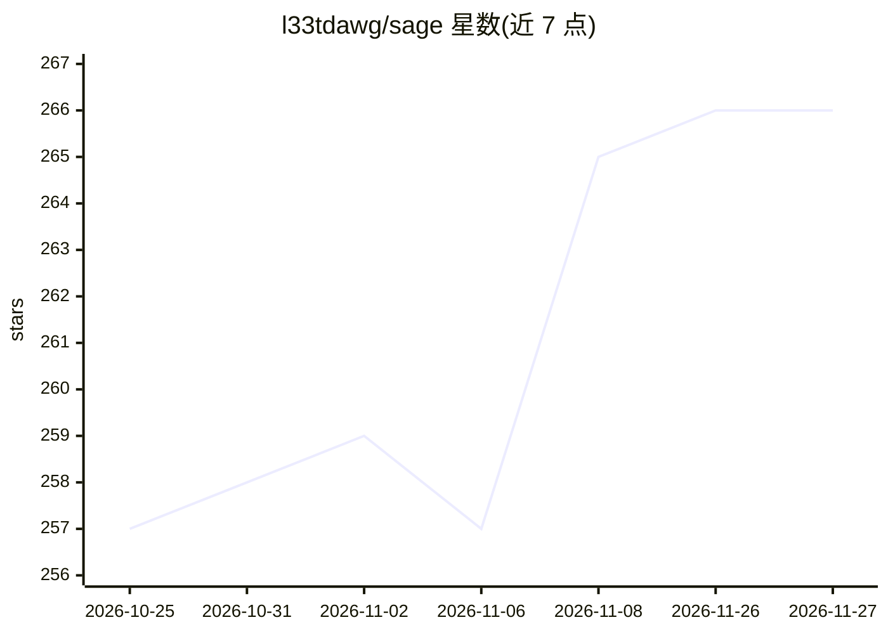

# l33tdawg/sage

⭐ 266 · Go · Apache-2.0 · 推送 2026-11-26 · [GitHub](https://github.com/l33tdawg/sage) · [官网](https://orcid.org/0009-0001-7248-2411) · 个人维护

**为 AI agent 提供带签名、审计与准入控制的记忆层**

SAGE 是面向 AI agent 的受治理记忆与消息层：每条记忆由 agent 签名、经可审查的准入流程、按权限范围存取，并保留可查验的审计轨迹。个人安装运行单个验证器投签名票，多验证器部署需 BFT 法定人数提交记忆。通过 MCP、Python SDK 或签名 REST API 接入 Claude Code、Codex、Cursor 等 MCP 客户端；本地 CEREBRUM 仪表盘提供 3D 记忆可视化、准入审核、权限与联邦管理。桌面安装包覆盖 macOS/Windows/Linux，亦可 Docker 或从 Go 源码构建。

## 筛选速览

| 维度 | 判定 | 备注 |
|---|---|---|
| AI 角色 | `ai-ecosystem` | LLM/agent 周边工具 |
| 许可风险 | `permissive` | Apache-2.0 |
| 部署形态 | `self-host` | docker 或自建部署 |
| 模型依赖 | local-ok | 支持本地模型 |
| 硬件要求 | — | 无带数字的原话,不猜 |
| 安装摩擦 | `low` | 无编译、无系统依赖或容器化 |
| 成熟度 | — | 结构信号不足 |

## 能力要点

- agent 签名写入 + 验证器准入生命周期，含审计轨迹与记忆衰减/弃用控制
- MCP、Python SDK、签名 REST API 三种接入方式
- CEREBRUM 本地仪表盘：3D MRI 记忆脑、链健康、联邦与召回调优
- 个人单验证器模式与 BFT 多验证器网络两种部署拓扑

## 适用场景

- 让 agent 跨会话记住设计决策与失败教训
- 团队需要审计 agent 写入的记忆与访问权限
- 多台 agent 节点间按策略做受控记忆联邦

## 场景标签

`Agent 记忆` · 领域:Agent 开发

## 证据(README 行号)

> L7: SAGE is a governed memory and messaging layer for AI agents. Every memory is
> L15: Works with Claude Code, Codex, Cursor and other MCP-capable clients. Developers
> L206: **Agents are not validators.** Personal mode runs one real CometBFT validator

## 星数曲线

2026-10-25 257 → 2026-11-27 266（+9）

---
*卡片 v1 · prompt 1.4 · 生成 2026-11-27 · 置信度 high · 依据 README sha `31e02693ee5b` · [字段定义](../../DATASET.md)*
