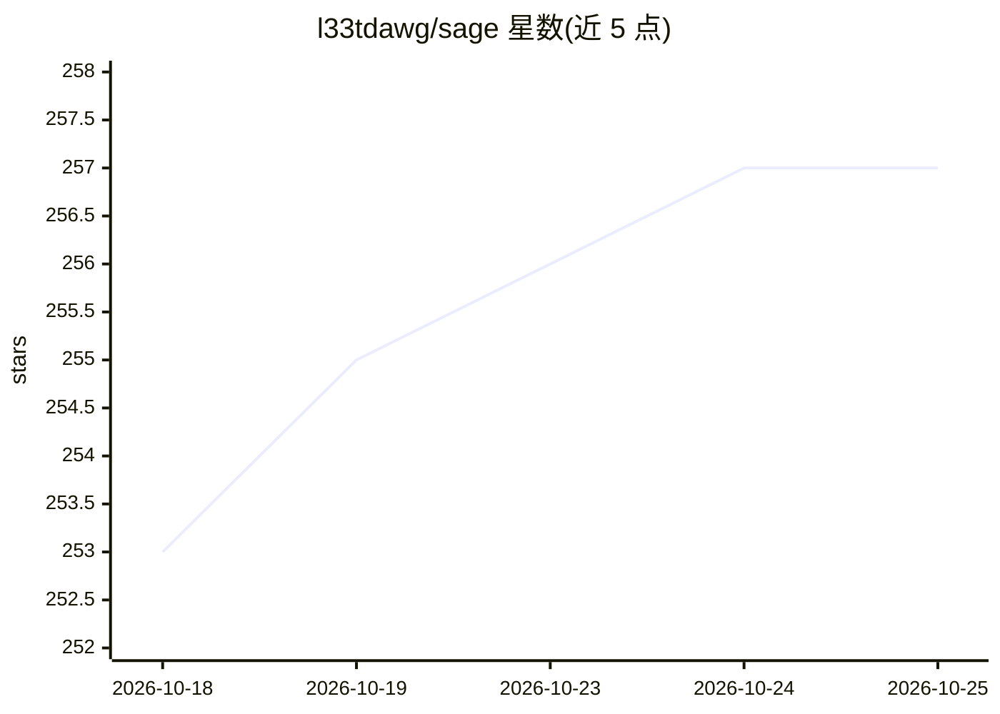

# l33tdawg/sage

⭐ 257 · Go · Apache-2.0 · 推送 2026-10-24 · [GitHub](https://github.com/l33tdawg/sage) · [官网](https://orcid.org/0009-0001-7248-2411) · 个人维护

**面向 AI agent 的治理型记忆与消息层，带共识准入与审计**

SAGE 是供 AI agent 使用的治理型记忆与消息层：每条记忆由 agent 签名写入、经可审查的准入流程（个人模式单验证者，多验证者部署需 BFT quorum/CometBFT）提交，并按角色、域权限与密级控制访问，保留可查验的审计轨迹。本地默认存储（BadgerDB + SQLite/pgvector），提供 CEREBRUM 网页控制台。接入方式包括 MCP（Claude Code、Codex、Cursor 等）、Python SDK 与签名 REST API。提供桌面安装包、源码构建（Go 1.26.9+）与 Docker 镜像。共识准入只治理提交内容，不证明记忆真实性，也不改变模型权重。

## 筛选速览

| 维度 | 判定 | 备注 |
|---|---|---|
| AI 角色 | `ai-ecosystem` | LLM/agent 周边工具 |
| 许可风险 | `permissive` | Apache-2.0 |
| 部署形态 | `self-host` | docker 或自建部署 |
| 模型依赖 | — | README 未给出锁定关系 |
| 硬件要求 | — | 无带数字的原话,不猜 |
| 安装摩擦 | `low` | 无编译、无系统依赖或容器化 |
| 成熟度 | — | 结构信号不足 |

## 能力要点

- Agent 签名写入 + BFT/CometBFT 共识准入的记忆治理机制
- MCP / Python SDK / 签名 REST API 三种接入方式
- CEREBRUM 本地控制台：3D MRI 记忆图谱、链健康、权限与召回调优
- 本地默认存储（BadgerDB + SQLite/PostgreSQL+pgvector），可选联邦与静态加密 vault

## 适用场景

- 让跨会话工作的 agent 保留可追溯的设计决策与经验教训
- 多 agent 协作中的任务分配、统一收件箱与运行时交接
- 对 agent 记忆做权限、密级与审计合规管理

## 场景标签

`Agent 记忆` `多智能体` · 领域:Agent 开发

## 证据(README 行号)

> L7: SAGE is a governed memory and messaging layer for AI agents. Every memory is
> L15: Works with Claude Code, Codex, Cursor and other MCP-capable clients. Developers
> L161: |MCP|Giving an existing AI client memory and coordination tools|Connection guide · MCP reference|

## 星数曲线

2026-10-18 253 → 2026-10-25 257（+4）

---
*卡片 v1 · prompt 1.4 · 生成 2026-10-22 · 置信度 high · 依据 README sha `2bbe2ff1c947` · [字段定义](../../DATASET.md)*
