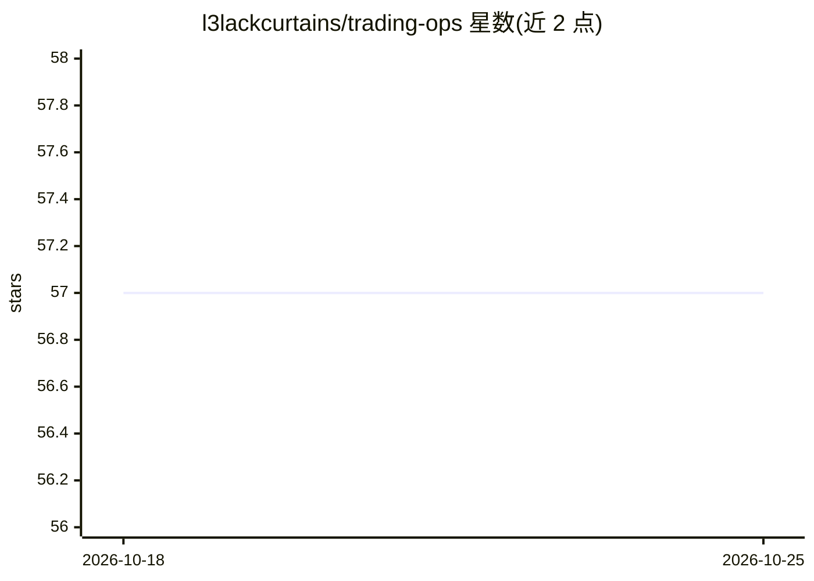

# l3lackcurtains/trading-ops

⭐ 57 · Python · MIT · 推送 2026-05-02 · [GitHub](https://github.com/l3lackcurtains/trading-ops) · 个人维护

**在 Claude Code 内运行的系统化交易分析工作区，一条命令扫描任意资产**

以 Claude Code 斜杠命令为核心的研究框架：/scan 自动识别股票、加密货币、指数、外汇、商品资产类别，调用 9 个 Python 脚本本地预取数据（Yahoo Finance、SEC EDGAR、CoinGecko 等，默认无需 API key），按宏观象限与 6 支柱框架输出结构化裁决（LONG/SHORT/WAIT）、ASCII 价格阶梯与交易表。每次扫描归档为本地 Markdown，重扫时做增量对比并分类此前触发器。不处理下单与告警，可通过 MCP 扩展 broker、Chrome、Slack 等集成。需 Claude Code CLI 与 Python 3.10+。

## 筛选速览

| 维度 | 判定 | 备注 |
|---|---|---|
| AI 角色 | `ai-native` | 本体是模型或模型工具 |
| 许可风险 | `permissive` | MIT |
| 部署形态 | `library` | 以包/库形式分发 |
| 模型依赖 | — | README 未给出锁定关系 |
| 硬件要求 | — | 无带数字的原话,不猜 |
| 安装摩擦 | `low` | 无编译、无系统依赖或容器化 |
| 成熟度 | — | 结构信号不足 |

## 能力要点

- 一条 /scan 命令自动识别 5 类资产并输出结构化裁决与交易表
- 9 个 Python 脚本本地预取数据，默认无需 API key
- 扫描结果归档为 Markdown，重扫支持增量对比与触发器分类
- 通过 MCP 可扩展 broker 下单、Chrome 图表、Telegram/Discord 告警

## 适用场景

- 对持仓或观察标的做带审计痕迹的定期扫描与重扫对比
- 先跑 /scan-macro 确定宏观象限，再做个股与加密货币分析
- 用 /discover 自然语言筛选并锚定当前宏观象限的候选标的

## 场景标签

`金融量化` · 领域:学习与行业

## 证据(README 行号)

> L3: A systematic trading workspace that runs inside Claude Code. One command scans any asset — stock, crypto, index, FX,
> L20: /scan AAPL        → 6-pillar fundamentals + Volume Profile + VWAP + trade plan
> L51: - **Claude Code** — the CLI that runs the slash commands

## 星数曲线

2026-10-18 57 → 2026-10-25 57（+0）

---
*卡片 v1 · prompt 1.4 · 生成 2026-10-24 · 置信度 mid · 依据 README sha `e97810945c35` · [字段定义](../../DATASET.md)*
